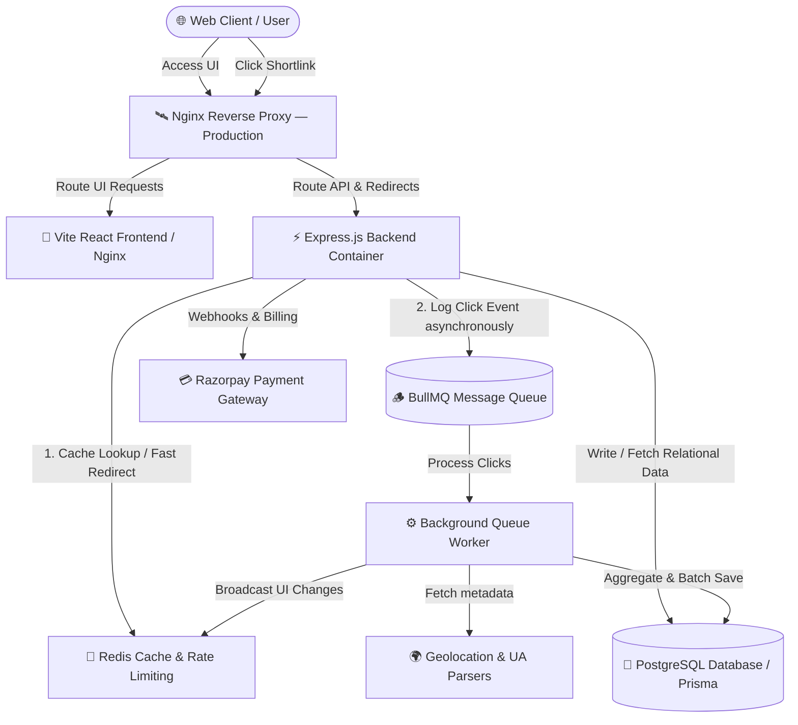
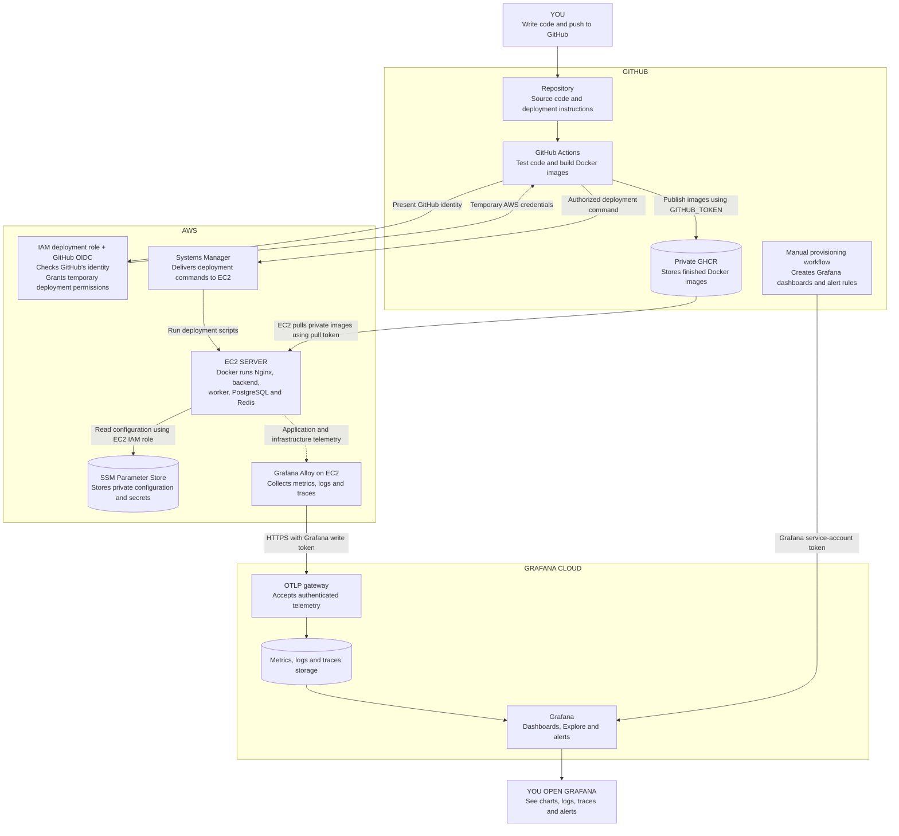

# 🔗 pbURLs — Enterprise-Grade SaaS URL Shortener & Real-Time Analytics

[](https://nodejs.org/)
[](https://react.dev/)
[](https://www.docker.com/)
[](https://www.prisma.io/)
[](https://redis.io/)

PBUrls is a modern, high-performance, enterprise-ready Software-as-a-Service (SaaS) URL shortener designed to support low-latency link redirection, real-time geolocation analytics, multi-tenant team workspaces, custom domains, and integrated subscription billing. 

Built with scalability, security, and developer experience in mind, this project represents an industry-standard implementation of a distributed, microservices-style full-stack application.

---

## 🏗️ System Architecture

PBUrls uses a decoupled, event-driven architecture designed to keep the redirect event loop highly optimized while offloading heavy processes (like telemetry, logging, and notifications) to background queues.



---

## ⚡ Technical Highlights & Rationale

*   **Sub-Millisecond Redirect Routing:** Redirect requests (`/r/:shortCode`) bypass complex database operations. The API checks **Redis** first. If cached, it issues a `302 Redirect` immediately; if not, it queries PostgreSQL, caches the result, and redirects.
*   **Asynchronous Click Telemetry (BullMQ):** Instead of stalling requests during write operations, every link click pushes an event to a **Redis-backed BullMQ queue**. Dedicated **Worker Processes** consume these jobs, perform IP Geolocation (`geoip-lite`) and User-Agent parsing (`ua-parser-js`), and batch-save analytics.
*   **Real-Time Data Streaming:** Real-time dashboards are powered by **Socket.io** utilizing a **Redis Adapter**, enabling horizontal scaling of WebSocket connections across multiple backend containers.
*   **Multi-Tenant Teams & Custom Domains:** Complete multi-user collaboration workflow including organization ownership, role management (`OWNER`, `ADMIN`, `MEMBER`), invitations, and support for mapping custom CNAMES.
*   **Secure Authentication & Identity Verification:** Enterprise-grade security containing rotated **JWT sessions** inside HTTP-only cookies, password hashing with **Bcrypt**, One-Time Password **2FA (TOTP)** verification, schema validation via **Zod**, and automated **Audit Logging**.
*   **Commercial SaaS Core:** Full integration with **Razorpay Subscriptions**, webhook idempotency handlers, custom coupon/redemption workflows, and fine-grained feature toggles linked to active subscription plans.

---

## 🚀 Enterprise Feature Deep-Dive

This section outlines the technical implementation details of all core services within the PBUrls ecosystem:

### 1. Core Shortener & Redirect Engine
*   **Decoupled Read/Write Path**: Separates link creation (write path) from client redirection (read path), optimizing each independently for maximum performance.
*   **Sub-3ms Redirection Loops**: Redirect routes (`/r/:shortCode`) utilize a **Cache-First** strategy via **Redis**, avoiding heavy database query latency on hot links.
*   **Base62 Collision Resolution Engine**: Autogenerates short codes using a Base62 character set (`[0-9a-zA-Z]`), offering \(62^6 = 56.8\) Billion unique combinations. Handles rare database collisions using an automatic self-healing loop (up to 5 retries).
*   **Dynamic Cache Invalidation**: Employs an invalidation pattern that evicts the Redis redirect target key instantly upon URL update or deletion, guaranteeing immediate target accuracy.
*   **Proxy-Aware IP Extraction**: Resolves the true visitor IP address behind reverse proxies (Nginx, Cloudflare, AWS Load Balancers) by parsing proxy headers in order of priority: `X-Forwarded-For` ➔ `X-Real-IP` ➔ `CF-Connecting-IP`.

### 2. Asynchronous Click Telemetry (Queue Pipeline)
*   **Non-Blocking Queue Ingestion (BullMQ)**: Pushes telemetry click events into a **Redis-backed BullMQ message queue** in under `2ms`. Releases the visitor's request connection thread immediately, preventing database lock contention during high traffic spikes.
*   **Geographic Telemetry Parsing**: Background workers execute out-of-band IP geolocations via local database lookups (`geoip-lite`), extracting the visitor's Country, State, City, Coordinates (Latitude/Longitude), and Timezone.
*   **Multi-Stage Bot & Spam Engine**:
    *   *Signature Analysis*: Evaluates browser User-Agent signatures against regex rules to detect search bots (Googlebot, Bingbot).
    *   *Behavioral Rate Limiting*: Implements a sliding window rate limiter in Redis. If a single IP makes **more than 10 clicks in 10 seconds** on a URL, it is flagged as a spam bot.
*   **Redis HyperLogLog (HLL) Unique Tracking**: Estimates unique visitors per URL bucket utilizing the HyperLogLog algorithm (`PFADD`). Keeps a fixed **12KB memory footprint** per key, achieving `O(1)` cardinality lookup speeds while reducing database storage requirements by 99%.

### 3. Aggregations & Real-Time Dashboards
*   **Pre-Calculated Rollup Tables**: Background workers upsert daily and hourly rollup tables (`UrlStatsDaily`/`UrlStatsHourly`) using atomic `ON CONFLICT DO UPDATE` queries. This makes rendering analytics charts instant, as the dashboard reads pre-aggregated summary rows instead of running slow queries on millions of raw click logs.
*   **Auto-Scaling Websocket Broadcasts**: Streams real-time click metrics to dashboard owners via **Socket.io**. Utilizes the **Redis Socket.io Adapter** to broadcast events across multiple autoscaling server instances, ensuring live updates work in cluster environments.

### 4. Identity & Access Management (IAM / Security)
*   **Stateful Refresh Token Rotation**: Implements a secure hybrid auth pattern:
    *   *Access Tokens*: Short-lived (15-minute) stateless JWTs passed in-memory.
    *   *Refresh Tokens*: Long-lived (30-day) stateful random strings stored in PostgreSQL and sent via `HttpOnly`, `Secure`, `SameSite=Lax` cookies.
*   **Token Versioning & Instant Revocation**: Checks user `tokenVersion` on every request. Incrementing this counter in PostgreSQL instantly invalidates all active sessions across all devices (e.g., during password resets or administrator bans).
*   **Resource Ownership Hiding (Hiding Pattern)**: If a user attempts to access a URL or resource they do not own, the system returns a `404 Not Found` rather than a `403 Forbidden`. This protects the system against ID crawling and resource enumeration attacks.
*   **Step-Up Boundary Enforcement**: Sensitive actions (e.g., account deletion, billing edits) require re-entering the user's password, which is verified dynamically in the route middleware to prevent session-hijacking compromises.

### 5. Multi-Tenant Workspaces (Teams)
*   **Collaborative Workspaces**: Supports multi-user team workspaces with permission boundaries.
*   **Workspace Role Model**: Users hold roles (`OWNER`, `ADMIN`, `MEMBER`) restricting workspace operations (inviting members, managing billing plans, deleting shared links).
*   **Covered Composite Indexing**: The `TeamMember` table implements a composite unique key `@@unique([team_id, user_id])`, ensuring that checking user access within a workspace is resolved in `O(1)` database index searches.

### 6. SaaS Billing & Subscription Engine
*   **Razorpay Integration**: Features standard checkout workflows mapped to multi-tier subscriptions.
*   **Dual-Channel Verify Resilience**:
    *   *Synchronous Signature Check*: Verifies Razorpay checkout signatures immediately after payment to upgrade user state instantly.
    *   *Idempotent Webhook Guard*: Ingests Razorpay webhooks (`payment.captured`, `payment.failed`) to ensure database consistency if the user closes their browser mid-checkout. Uses Redis locks (`SET NX`) and unique event table indexes to prevent duplicate activations.
*   **Redis Quota Gating**: Caches subscription limits in Redis hashes (`limits:userId`). The URL shortening controller checks these limits (`O(1)` lookup) to enforce active plan quotas (e.g. maximum URLs, custom domain access).
*   **Alphanumeric Discount Coupons**: Features coupon validation calculations (checking dates, active status, max usage counts, and user validation) to apply percentage/flat discounts before initializing payment orders.

### 7. On-the-Fly QR Code Engine
*   **Compute-On-Demand Generation**: Generates QR codes dynamically on request as a Base64-encoded PNG image stream, saving substantial database and bucket storage space.
*   **Reed-Solomon Error Correction**: Employs error correction algorithms (recovering up to 15% image damage), allowing the code to remain scan-friendly on physical prints or if decorated with custom styles.
*   **Scanner Source Telemetry**: Automatically encodes a query parameter (`?qr=true`) inside the generated QR link. When scanned, the redirect controller extracts this flag to log QR scan analytics separately from standard web link clicks.

---

## 📂 Deep-Dive Documentation References

For deep-dive architectural blueprints, system designs, algorithm analyses, and file mappings of individual subsystems, refer to the dedicated documents:

*   **Session Management & Auth Flow**: [AUTH_README.md](file:///c:/Users/prash/OneDrive/Desktop/url_shortner/AUTH_README.md)
*   **Authentication Sequence Flowcharts**: [AUTH_FLOWS.md](file:///c:/Users/prash/OneDrive/Desktop/url_shortner/AUTH_FLOWS.md)
*   **Authentication System Design Rationale**: [AUTH_SYSTEM_DESIGN.md](file:///c:/Users/prash/OneDrive/Desktop/url_shortner/AUTH_SYSTEM_DESIGN.md)
*   **Workspace & Role Access Guards (RBAC / ReBAC)**: [AUTHZ_README.md](file:///c:/Users/prash/OneDrive/Desktop/url_shortner/AUTHZ_README.md)
*   **Authorization System Design & Webhook Audits**: [AUTHZ_SYSTEM_DESIGN.md](file:///c:/Users/prash/OneDrive/Desktop/url_shortner/AUTHZ_SYSTEM_DESIGN.md)
*   **Click Telemetry & Analytics Pipeline**: [ANALYTICS_README.md](file:///c:/Users/prash/OneDrive/Desktop/url_shortner/ANALYTICS_README.md)
*   **Analytics Event Flowcharts & Websocket Updates**: [ANALYTICS_FLOWS.md](file:///c:/Users/prash/OneDrive/Desktop/url_shortner/ANALYTICS_FLOWS.md)
*   **Analytics System Design & Scaling (HLL / Rollups)**: [ANALYTICS_SYSTEM_DESIGN.md](file:///c:/Users/prash/OneDrive/Desktop/url_shortner/ANALYTICS_SYSTEM_DESIGN.md)
*   **Subscription & Razorpay Transaction Pipeline**: [PAYMENTS_README.md](file:///c:/Users/prash/OneDrive/Desktop/url_shortner/PAYMENTS_README.md)
*   **Payments System Design & DSA (Idempotency Locks / ZSET Sweeps)**: [PAYMENTS_SYSTEM_DESIGN.md](file:///c:/Users/prash/OneDrive/Desktop/url_shortner/PAYMENTS_SYSTEM_DESIGN.md)
*   **Shortening & Redirect Event Handling**: [REDIRECTION_README.md](file:///c:/Users/prash/OneDrive/Desktop/url_shortner/REDIRECTION_README.md)
*   **Redirection System Design & Base62 Encoders**: [REDIRECTION_SYSTEM_DESIGN.md](file:///c:/Users/prash/OneDrive/Desktop/url_shortner/REDIRECTION_SYSTEM_DESIGN.md)
*   **QR Code Reed-Solomon Grid & Scan Tracking System**: [QR_CODE_SYSTEM_DESIGN.md](file:///c:/Users/prash/OneDrive/Desktop/url_shortner/QR_CODE_SYSTEM_DESIGN.md)
*   **Queue-Worker Bridge Transaction Details**: [QUEUE_WORKER_BRIDGE.md](file:///c:/Users/prash/OneDrive/Desktop/url_shortner/QUEUE_WORKER_BRIDGE.md)

---

## 🛠️ Technology Stack

| Layer | Technology | Purpose |
| :--- | :--- | :--- |
| **Frontend** | React, Vite, ES6 modules | Single-Page Application (SPA) dashboard & widgets |
| **Backend** | Node.js, Express.js | Core API and lightning-fast redirect controllers |
| **Database** | PostgreSQL | Relational transactional database (users, teams, URLs, logs) |
| **ORM** | Prisma | Type-safe schema definitions, database migrations, and queries |
| **Caching / Broker** | Redis | Caching, session management, rate-limiting, and queues |
| **Background Queues** | BullMQ | Distributed background jobs and task runner |
| **Payments** | Razorpay SDK & Webhooks | Multi-tier billing, checkouts, and subscription lifecycle |
| **Containerization** | Docker, Docker-compose | Virtualization and environment parity |
| **CI / Image Builds** | GitHub Actions | Tests, cached builds, private GHCR publishing, and SSM deployments |

---

## 🗄️ Database Schema Overview

PBUrls uses a relational schema optimized with indexes for query speeds. Click records are structured for fast aggregations, and subscriptions bind features directly to users.

*   `User` & `RefreshToken`: Manages multi-device login sessions, TOTP/2FA settings (`twoFactorSecret`), role configurations, and billing credentials.
*   `Url` & `Click`: Links short codes to target destinations. Relies on indexes for `short_code` lookup speed. Contains extensive browser/device/geographic telemetry fields.
*   `UrlStatsHourly` & `UrlStatsDaily`: Aggregated tables updated asynchronously to prevent heavy analytical query overhead on the live click log.
*   `Plan` & `PlanLimit`: Decouples business pricing from functional limits (e.g., maximum links allowed, webhooks permitted, custom domain authorization).
*   `Team` & `TeamMember`: Manages tenant workspaces and shared link configuration access.
*   `Payment` & `WebhookEvent`: Supports idempotent processing of transactions and billing webhooks (preventing double captures/activations).

---

## 🚀 Local Quickstart (4 Docker containers + native development)

Daily development runs PostgreSQL, Redis, Alloy and LGTM in Docker. The backend, worker and frontend run directly on your laptop with code watching and hot reload.

### Prerequisites
- [Docker & Docker Compose](https://www.docker.com/get-started/)
- Node.js 24 (see `.node-version`)

### Steps

1. **Clone the Repository:**
   ```bash
   git clone https://github.com/your-username/pburls.git
   cd pburls
   ```

2. **Configure Environment Variables:**
   Copy the root `.env.example` to `.env` only if it does not exist, and fill in local settings. Compose reads this same file for database initialization and backend/worker settings. Keep `DB_*` credentials and `DATABASE_URL` consistent, especially with an existing database volume.

   Native Node development, production, CI, and frontend mode-specific examples are documented in [ENVIRONMENT.md](ENVIRONMENT.md). Real env files are ignored; only safe examples belong in Git.

3. **Start the four infrastructure containers:**
   ```bash
   node infrastructure/scripts/local.mjs up
   ```

4. **Install dependencies and initialize the local database once:**
   ```bash
   npm --prefix backend ci
   npm --prefix frontend ci
   npm --prefix backend run dev:setup
   ```
   Configure native backend secrets in `backend/.env.development.local` using the development example. If no native `DATABASE_URL` is configured, the launcher derives it from the root Docker configuration and published database port. Existing private env files are retained; do not overwrite them. `dev:setup` generates Prisma, applies migrations and seeds plans; run it deliberately at setup or after schema changes, not on every restart.

5. **Start backend and worker together, then frontend in a second terminal:**
   ```bash
   npm --prefix backend run dev
   ```
   ```bash
   npm --prefix frontend run dev
   ```
   - Frontend: `http://localhost:5173`
   - Backend: `http://localhost:5000`
   - Grafana: `http://localhost:3001` → Dashboards → PBUrls

The backend `dev` command starts both backend and worker with hot reload. Ctrl+C stops both. Use `dev:backend` or `worker:dev` only when deliberately running a single service; stop those standalone processes before using the combined command. The native launchers enable telemetry, assign separate service identities/metrics ports and prevent the backend from forking a duplicate worker. `node infrastructure/scripts/local.mjs stop` stops the infrastructure containers while retaining their data.

For the complete seven-container integration workflow, stop the native processes first and run `node infrastructure/scripts/local.mjs --full-stack up`. That serves the frontend through Nginx at `http://localhost:3000`. Returning to the default `up` stops application containers before starting the four infrastructure services. The launcher reuses the existing PostgreSQL/Redis Compose project so a checkout rename does not select new database volumes.

---

## Production deployment and CI/CD

**Production AWS region: `us-east-1` (N. Virginia).** Deployment/rollback workflows and AWS scripts select this region. Set GitHub `AWS_REGION=us-east-1` and use EC2, storage, networking and SSM parameters from this region. Code changes do not relocate existing AWS resources. Follow the [region setup instructions](infrastructure/DEPLOYMENT.md#deployment-region-us-east-1-n-virginia) before enabling deployment. Grafana Cloud keeps its own supplied ingestion endpoint.

GitHub Actions tests the application, builds cached backend/migration/Nginx images, and publishes private packages to GHCR. The production deployment uses AWS OIDC and Systems Manager to pull exact image digests, migrate once, issue/renew HTTPS certificates, and verify the release. Deployment remains disabled until the AWS/domain configuration is supplied.

See [infrastructure/DEPLOYMENT.md](infrastructure/DEPLOYMENT.md) for infrastructure provisioning, secret setup, GitHub configuration, operations, and rollback. No Kubernetes or S3 is required.

Environment templates and mode-selection rules are documented in [ENVIRONMENT.md](ENVIRONMENT.md).

### How GitHub, AWS and Grafana Cloud work together

There are two separate flows: **deployment delivers the application**, and **observability reports how it behaves**. Think of GitHub Actions as the factory, GHCR as the warehouse, EC2 as the place the application runs, and Grafana Cloud as the monitoring room. This diagram describes the configured production architecture after its credentials, permissions and deployment settings are ready.



#### Follow the deployment flow

1. **Push code:** the configured workflow runs for pushes to `main` and pull requests targeting `main`. GitHub installs dependencies, tests the application and builds production images on its runners.
2. **Store the release:** GitHub Actions publishes private GHCR images on non-PR runs. Built-image smoke tests and security checks must pass before deployment. The release manifest identifies exact image digests, so EC2 downloads the selected version.
3. **Prove GitHub's identity:** OIDC means OpenID Connect. GitHub presents a signed identity token; AWS checks the IAM deployment role's trust rules and issues temporary credentials. The role limits the permitted AWS actions. No permanent AWS access key is required in GitHub.
4. **Deliver instructions:** Actions uses those temporary credentials to send a command through Systems Manager. The SSM agent on EC2 receives it; public SSH is not required by this deployment.
5. **Run the release:** EC2 uses its own IAM role to retrieve allowed Parameter Store values, authenticates to GHCR using a separate read-only token, pulls images, prepares storage, applies migrations and updates containers. It does not compile the frontend or install application npm dependencies on the host.
6. **Verify success:** deployment checks application readiness and HTTPS before recording the release as current. Deployment runs only when enabled and its production-environment requirements are satisfied; PRs and scheduled runs do not deploy production.

An OIDC provider identifies the trusted issuer; the role's trust policy identifies which repository/environment may assume it; its permission policy defines the allowed actions. An organization-level explicit deny can block this setup even when an account role has administrator permissions. Manual Console creation does not bypass that restriction. Reuse an approved provider/role or resolve the restriction with the organization administrator before enabling this deployment.

#### Follow the observability flow

The backend and worker expose metrics and send structured logs/traces to Alloy. Alloy also reads PostgreSQL, Redis and production host statistics, and probes public HTTPS. It forwards telemetry directly to Grafana Cloud over authenticated HTTPS. Grafana stores the data and displays dashboards, log searches and trace timelines. GitHub is not in this continuous telemetry path.

The separate **Provision observability dashboards and alerts** workflow is manually triggered: it configures Grafana using a service-account token. It does not deliver application telemetry. Alert notifications also require a Grafana contact point and notification policy. For exact libraries, collector components, sampling defaults and current coverage limits, see the [ordered observability diagrams](infrastructure/observability/README.md#architecture-diagrams-read-in-this-order).

#### Which credential does what?

| Credential or role | Used by | Purpose |
|---|---|---|
| GitHub `GITHUB_TOKEN` | Build workflow | Publish private container images to GHCR. |
| GitHub OIDC identity + AWS deployment role | Deployment workflow | Obtain temporary AWS credentials and send authorized SSM commands. |
| EC2 instance role | EC2 / SSM agent | Connect to Systems Manager and read allowed production parameters. |
| GHCR read-only pull token | Docker on EC2 | Download the private application and deployment images. |
| Grafana Cloud access-policy token | Alloy on EC2 | Write metrics, logs and traces to the selected Cloud stack. |
| Grafana service-account token | Dashboard-provisioning workflow | Create/update project dashboards and alert rules. |
| PostgreSQL monitoring password | Alloy's PostgreSQL exporter | Read database statistics through the dedicated monitoring role. |

These credentials serve different purposes and are not interchangeable. An instance ID, role ARN or datasource UID identifies a resource; it does not grant access by itself. Keep real tokens and passwords out of Git and Docker images.

#### Where the key-value settings belong

| Location | Keys or parameter names | Meaning |
|---|---|---|
| GitHub repository variables | `AWS_REGION=us-east-1`, `EC2_INSTANCE_ID`, `AWS_DEPLOY_ROLE_ARN` | Deployment region, target instance and role GitHub requests. |
| GitHub repository variables | `GHCR_PULL_USERNAME`, `PARAMETER_PREFIX`, `PROD_DEPLOY_ENABLED` | Registry account, configuration prefix and deployment switch. |
| SSM SecureString | `/pburls/production/runtime-env` | Application URLs, database credentials, JWT secret and enabled integration settings. |
| SSM SecureString | `/pburls/production/ghcr-token` | EC2's read-only GHCR pull token. |
| SSM String, created by the AWS template | `/pburls/production/data-volume-id` | Identity of the persistent EBS data volume. |
| SSM SecureString | `/pburls/production/observability-env` | `OTLP_ENDPOINT` is the Cloud ingestion address; `OTLP_USERNAME` is its instance ID; `OTLP_PASSWORD` is the Cloud write token; `OBS_POSTGRES_PASSWORD` is the separate database monitoring password. |
| GitHub production-environment variables | `GRAFANA_URL`, `GRAFANA_PROMETHEUS_UID`, `GRAFANA_LOKI_UID` | Grafana website and the metrics/logs datasources used by provisioned dashboards. |
| GitHub production-environment secret | `GRAFANA_SERVICE_ACCOUNT_TOKEN` | Permission for dashboard and alert-rule provisioning. |

The `/pburls/production` prefix is configurable. The Grafana website URL and the OTLP ingestion endpoint are different addresses. Use values from the same intended Grafana stack, and obtain replacement credentials privately if a token has been shared. Follow the [production setup guide](infrastructure/DEPLOYMENT.md#one-time-setup) to configure these values in order.

---

## 🔗 Key API Endpoints (Core List)

| Method | Route | Auth | Description |
| :--- | :--- | :--- | :--- |
| **GET** | `/health` | None | API Service Status check |
| **GET** | `/r/:shortCode` | None | Quick Redirection Service (Cached) |
| **POST** | `/api/auth/register` | None | User Account creation |
| **POST** | `/api/auth/login` | None | Credentials authentication |
| **POST** | `/api/urls` | Active | Shorten a single destination URL (Rate Limited) |
| **POST** | `/api/urls/bulk` | Active | Create bulk shortened URLs (Enterprise feature) |
| **GET** | `/api/urls/:shortCode/qr` | Active | Generate/fetch dynamic URL QR Code |
| **GET** | `/api/analytics/dashboard`| Active | Fetch click stats aggregated daily/hourly |
| **POST** | `/api/payments/webhook` | Webhook | Razorpay Instant Payment IPN Handler |

---

## 📄 License
This project is licensed under the ISC License. See the [LICENSE](LICENSE) file for details.
## Observability

Local Grafana, production Grafana Cloud, metrics/logs/traces, dashboards, alert rules and repeatable performance comparisons are documented in [the observability guide](infrastructure/observability/README.md).

Read the architecture diagrams in sequence. The guide explains each library/tool, the four-container local setup, production collection on EC2, and viewing results in Grafana Cloud:

1. [The application journey and its signals](infrastructure/observability/README.md#diagram-1-the-application-journey-and-its-signals)
2. [Collection: pull versus push](infrastructure/observability/README.md#diagram-2-collection-pull-versus-push)
3. [Deployment overview: local and production](infrastructure/observability/README.md#diagram-3-deployment-overview-local-and-production)
4. [Local application and instrumentation](infrastructure/observability/README.md#diagram-4-local-application-and-instrumentation)
5. [Local telemetry: collection, storage and display](infrastructure/observability/README.md#diagram-5-local-telemetry-collection-storage-and-display)
6. [Exact local libraries and collector components](infrastructure/observability/README.md#diagram-6-exact-local-libraries-and-collector-components)
7. [Production: EC2 collection and Grafana Cloud](infrastructure/observability/README.md#diagram-7-production-ec2-collection-and-grafana-cloud)
8. [One redirect: request, trace and background job](infrastructure/observability/README.md#diagram-8-one-redirect-request-trace-and-background-job)
