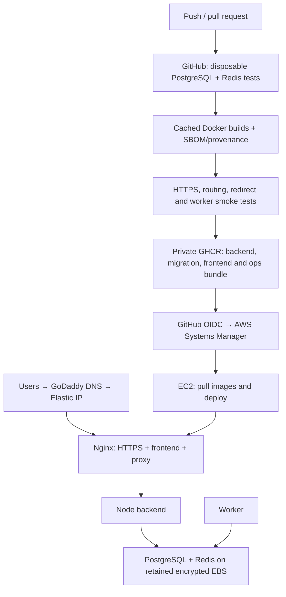

# Production deployment

This setup builds on GitHub-hosted runners, stores **private** images in GHCR, and deploys finished images over AWS Systems Manager. EC2 does not clone Git, install npm packages, or build React. No Kubernetes or S3 is required. Optional production observability uses one Alloy collector with Grafana Cloud; see [observability/README.md](observability/README.md) for activation.

## Architecture

Start with the [GitHub → AWS → Grafana Cloud flow and credential guide](../README.md#how-github-aws-and-grafana-cloud-work-together) for the full system diagram, an easy walkthrough of OIDC/SSM, and where each key-value setting belongs. The diagram below focuses on deploying and serving the application; the [observability guide](observability/README.md) expands telemetry collection and storage.



The backend and worker share a small runtime image with production dependencies and a generated Prisma client. A separate migration image contains Prisma CLI and seed tools. The frontend image contains Nginx and static files only. The tiny ops image transports the Compose manifest, scripts, and exact image digests without S3.

Only ports 80 and 443 are public. PostgreSQL, Redis, backend, metrics, and worker have no published production ports. Nginx overwrites forwarded headers; Express trusts only the configured Docker subnet. The backend still has outbound access for email, OAuth, payments, and link checks.

## One-time setup

### Deployment region: us-east-1 (N. Virginia)

Deployment and rollback workflows, the SSM dispatcher and host scripts use **`us-east-1`**. Set GitHub's `AWS_REGION` variable to `us-east-1` as well; the workflows explicitly select this region. The configuration helper defaults to it and rejects conflicting region values. Check repository and `production` environment variables for stale values.

Use an EC2 instance, VPC/subnet, data EBS volume, Elastic IP and SSM parameters in `us-east-1`. Select a subnet and data volume availability zone in that region. Existing resources in another region are not moved by these code changes; do not reuse their regional IDs or delete their data. Update `EC2_INSTANCE_ID`, DNS and region-specific IAM resource ARNs to match the intended deployment. IAM roles and OIDC providers are global, but their policies may reference regional resources.

In CloudShell, select N. Virginia and set:

```bash
export AWS_REGION=us-east-1
export AWS_DEFAULT_REGION=us-east-1
export AWS_PAGER=""
```

When deploying the uploaded template, pass `--region us-east-1` to `aws cloudformation deploy`. Supply the actual VPC, public subnet and matching availability zone from that region. An existing failed stack in another region is a separate resource and is not repaired by switching regions.

Grafana Cloud's OTLP endpoint belongs to the Grafana stack and can be in a different region; retain the exact endpoint Grafana supplies. Changing AWS regions does not resolve an organization-level IAM/OIDC explicit deny.

### 1. Provision AWS resources

Use `aws/stack.yml` in CloudFormation, or adapt its settings to an existing EC2 instance. Review the template before creating resources; running it creates billable AWS infrastructure.

The template uses an existing VPC and **public subnet** with an internet-gateway route. Select the same availability zone for the subnet and data volume. It creates:

- Ubuntu 24.04 x86_64 EC2; start with the size appropriate to your measured traffic.
- A 30 GiB encrypted root volume and separate configurable encrypted gp3 data volume.
- A retained data volume, termination protection, and Elastic IP.
- Ingress on 80/443 only; Systems Manager replaces public SSH.
- An EC2 IAM role for SSM and the application's Parameter Store prefix.
- A GitHub OIDC deployment role restricted to this repository's `production` environment and this EC2 instance.

If your AWS account already has the GitHub OIDC provider, pass its ARN to avoid creating a duplicate. The template creates no VPC, NAT gateway, load balancer, RDS, Redis service, or S3 bucket.

Record the stack outputs: instance ID, data volume ID, Elastic IP, and deployment-role ARN. Wait until the instance is **Online** in Systems Manager. The official Ubuntu AWS image includes the SSM agent; check its installation/connectivity if it does not appear.

### 2. Point the domain at EC2

At GoDaddy, create the hostname's **A record** pointing to the Elastic IP. Remove conflicting records. Do not add an AAAA record unless you separately configure IPv6. If a CAA record exists, it must permit Let's Encrypt.

This configuration handles one canonical hostname. Add other hostnames, certificates, and redirects explicitly later. DNS must resolve publicly and ports 80/443 must be reachable before the first certificate can be issued. Port 80 remains open for ACME renewal and redirects other traffic to HTTPS.

### 3. Store private runtime configuration

Prepare a private production env file using `backend/.env.production.example`. Fill in:

- `DOMAIN`, `BASE_URL`, `CLIENT_URL`, and `LETSENCRYPT_EMAIL`.
- Unique database credentials and matching URL (`db:5432` inside Docker).
- A unique random JWT secret of at least 32 characters.
- SMTP/payment/OAuth credentials for the integrations you enable. OAuth callback URLs must match provider registrations.
- `ALLOW_FORMAT_DATA_VOLUME=true` **only for initial setup of the new blank volume**. Change back to false afterward.

The supplied stack records the volume ID in Parameter Store; leave `DATA_VOLUME_ID` blank to use it. For an existing EC2 host, supply the attached data volume's ID explicitly. Never point it at your operating-system disk. The installer matches the NVMe serial to that volume ID, refuses the root disk, and formats only an entirely blank unpartitioned volume when explicitly enabled.

The production Compose file sets proxy trust to `APP_SUBNET`, default `172.30.50.0/24`; choose a nonconflicting subnet if your network already uses it. Runtime credentials are injected, never baked into an image.

Upload the env file to Parameter Store as a **SecureString** (standard tier limit is 4 KiB; use advanced tier for a larger value):

```bash
aws ssm put-parameter --name /pburls/production/runtime-env \
  --type SecureString --value file://production.env --overwrite --region us-east-1
```

Use the default SSM KMS key with the supplied IAM policy. If you choose your own KMS key, add an appropriately scoped `kms:Decrypt` permission to the EC2 role. Restrict local file permissions and do not commit the real file. This implementation expects single-line values; single-quote passwords containing `$` or `#` to preserve literal values consistently with Compose.

Create a GitHub personal access token (classic) with **read:packages**, owned by an account that can read all four private packages. Authorize organization SSO if needed. Store it as another SecureString:

```bash
# Put the token in a protected file without a trailing newline; don't paste it into shell history.
aws ssm put-parameter --name /pburls/production/ghcr-token \
  --type SecureString --value file://ghcr-token.txt --overwrite --region us-east-1
```

GitHub Actions publishes with its built-in `GITHUB_TOKEN`; EC2's separate token only pulls. The token is fetched at deployment time and Docker's credentials are root-readable under `/etc/pburls/docker`. Rotate it before expiration. GitHub packages should remain **Private** and linked to this repository; never make them public to resolve an authentication error.

### 4. Configure GitHub once

Create the GitHub `production` environment and limit its deployment branches to `main`. The OIDC role relies on this restriction. Required reviewers are optional if your GitHub plan supports them.

Repository variables:

| Variable | Value |
| --- | --- |
| `AWS_REGION` | `us-east-1` (N. Virginia) |
| `EC2_INSTANCE_ID` | Stack instance output |
| `AWS_DEPLOY_ROLE_ARN` | Stack role output |
| `GHCR_PULL_USERNAME` | Account that owns the read-only package token |
| `PARAMETER_PREFIX` | `/pburls/production` unless customized |
| `PROD_DEPLOY_ENABLED` | `false` during setup; `true` when ready |

You can automate this with GitHub CLI from your workstation/CloudShell:

```bash
gh auth login
export AWS_REGION=us-east-1
export EC2_INSTANCE_ID=YOUR_INSTANCE_ID
export AWS_DEPLOY_ROLE_ARN=YOUR_ROLE_ARN
export GHCR_PULL_USERNAME=YOUR_GITHUB_USERNAME
bash infrastructure/scripts/configure-github.sh OWNER/REPOSITORY
```

This script does not set or upload application secrets. If environment policies are unavailable for your private repository's GitHub plan, resolve that before enabling the environment-based OIDC deployment.

Allow Actions to write packages. No Docker Hub password, AWS access key, EC2 private SSH key, or application secret belongs in the workflow. Protect `main` with the test/build checks appropriate to your repository permissions.

### 5. First release

Commit the reviewed application and DevOps changes and push to `main`. The workflow tests and builds before any deployment. With deployment disabled, it still publishes private images and a digest-pinned ops bundle. GitHub's Actions summary and release artifact identify the built version.

After DNS and Parameter Store are ready:

```bash
gh variable set PROD_DEPLOY_ENABLED --repo OWNER/REPOSITORY --body true
gh workflow run ci-cd.yml --repo OWNER/REPOSITORY --ref main
```

The first deployment installs Docker Engine/Compose and AWS CLI once, mounts EBS, validates runtime settings, starts the database/Redis, migrates, seeds plans if the plan table is empty, and starts the app. It serves only ACME and a health endpoint over HTTP until a real certificate is issued. Failed certificate issuance leaves initial setup unavailable rather than publishing the app over plaintext.

Admin creation is a deliberate one-time operation, not part of every release. Set all three admin seed variables, then use a root SSM session:

```bash
source /opt/pburls/current/infrastructure/scripts/common.sh
load_release /opt/pburls/current
dc run --rm --no-deps migrate node prisma/seedAdmin.js
```

Clear the admin seed variables from Parameter Store afterward and deploy the config change. The seed updates an existing administrator's credentials, so do not schedule it automatically.

## Every later release

1. Run isolated unit/integration tests and validate shell/Python/AWS configuration.
2. Build cached images on GitHub with locked npm dependencies and no application secrets.
3. Test the actual images with a disposable PostgreSQL/Redis stack, self-signed **test-only** HTTPS, routing checks, and a real redirect → BullMQ → worker → database click.
4. Scan runtime images; fixable high/critical vulnerabilities block deployment.
5. Publish SBOM/provenance and immutable digests; deliver the deployment bundle through private GHCR.
6. Assume the scoped AWS role using OIDC and issue an SSM command; wait for its result.
7. On EC2, pull images, validate production settings and storage, and take an optional local pre-migration dump.
8. Run migration once, update backend/worker/frontend, verify readiness and HTTPS, and record the current/previous release.

Normal application releases do not recreate existing PostgreSQL or Redis containers. Infrastructure-image upgrades require a separate maintenance operation. Existing images are used on reboot; startup does not rebuild or download dependencies. A Docker/systemd dependency prevents containers starting on an unmounted data disk.

Dependency installation layers survive ordinary source changes. npm cache mounts speed local rebuilds; GitHub's external BuildKit cache preserves layers between runners. BuildKit cache mounts themselves are not automatically exported to GitHub cache. Actions are pinned to verified commit SHAs, and Dependabot proposes updates. Weekly scheduled runs build/test refreshed bases but do not automatically deploy them.

Frontend lint is blocking and requires zero errors and warnings. Tests, configuration checks, builds, vulnerability scans, and container smoke checks are also blocking. Workflow runners are pinned to Ubuntu 24.04 to avoid unexpected changes when GitHub updates its `ubuntu-latest` image.

## Nginx behavior

- Static React files, SPA fallback, immutable caching for hashed `/assets/`, and revalidation for HTML.
- Gzip, upstream keepalive, automatic Docker DNS re-resolution after backend replacement.
- TLS 1.2/1.3, HTTP/2, session caching, disabled session tickets, and initially one-day HSTS.
- Scheduled Let's Encrypt renewal twice daily; Nginx configuration validation and graceful reload.
- `/api/` and `/r/` reverse proxy, Socket.IO upgrades, unbuffered MCP streaming.
- No proxy cache for APIs/redirects; no accidental loss of analytics through cached redirects.
- Request/body/time limits, forwarded-header replacement, hidden-file blocking, internal readiness/metrics blocked at the public edge.
- JSON access logs exclude query strings to keep OAuth codes out of logs; Docker rotates logs.

Rate limits remain in the application; this avoids imposing a second arbitrary edge limit on legitimate redirects. Nginx can load-balance additional backends later. This single EC2 setup provides no high availability or guaranteed zero-downtime releases; app replacement can briefly interrupt requests/WebSockets. Browser performance/RUM and a full telemetry backend remain deferred.

## Rollback and data protection

Run the separate **Roll back production application** workflow on `main`. The host retains the previous manifest/images and switches the application back. Automatic failed-release recovery also attempts to restore the previous application images.

Database migrations are **not reversed**. Use additive, backward-compatible migrations; incompatible changes may require a forward fix. Rollback does not restore old runtime secrets, database contents, or cloud resources.

There are **no S3 backups**. By default, deployment retains the three newest compressed PostgreSQL dumps in `/srv/pburls-data/migration-backups`; they are only a local recovery aid. Set `PRE_MIGRATION_BACKUP=false` if you explicitly want to skip them. A failed/empty backup stops the deployment. Redis uses AOF/every-second syncing and no eviction; abrupt failure can still lose the newest writes.

EBS survives EC2 stop/start; the retained data volume also survives stack deletion/replacement, subject to AWS lifecycle and manual actions. EBS is not an independent backup, and these local dumps do not protect against losing the data volume. Stopping EC2 takes the whole website offline; EBS and Elastic IP charges can continue.

Do not run production `down -v`, volume deletion, broad Docker prune commands, or disk formatting. The deployment never performs these. Image cleanup is deliberately manual: retain current/previous images and ensure root/data disks have free space. Old release directories are small; unused image layers can accumulate over time.

## Operations

Connect through Systems Manager as root, then:

```bash
source /opt/pburls/current/infrastructure/scripts/common.sh
load_release /opt/pburls/current
dc ps
dc logs --tail=100 backend worker frontend
docker stats --no-stream
df -h / /srv/pburls-data
systemctl list-timers pburls-renew.timer
journalctl -u pburls-renew.service --since today
```

Never publish resolved `docker compose config` output or Parameter Store values. `config --quiet` checks syntax without displaying secrets. Deployment output is recorded in GitHub/SSM; certificate-renewal failures are in the systemd journal. Add external uptime/expiry alerts when monitoring is enabled.

Changes to runtime Parameter Store values take effect on the next deployment. Nginx certificate files and renewal metadata live on EBS. Existing DNS and certificate settings must be deliberately updated if you change the canonical domain.

References: [Docker caching](https://docs.docker.com/build/ci/github-actions/cache/), [GHCR authentication](https://docs.github.com/en/packages/working-with-a-github-packages-registry/working-with-the-container-registry), [SSM Run Command](https://docs.aws.amazon.com/systems-manager/latest/userguide/run-command.html), [Certbot renewal](https://eff-certbot.readthedocs.io/en/stable/using.html#renewing-certificates).
