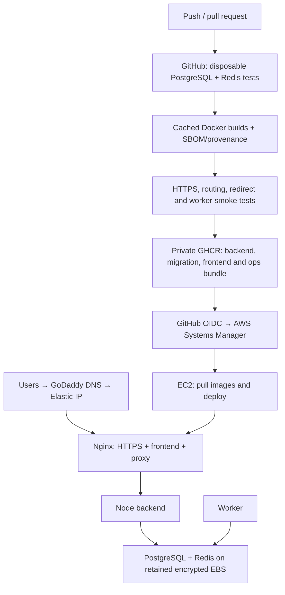
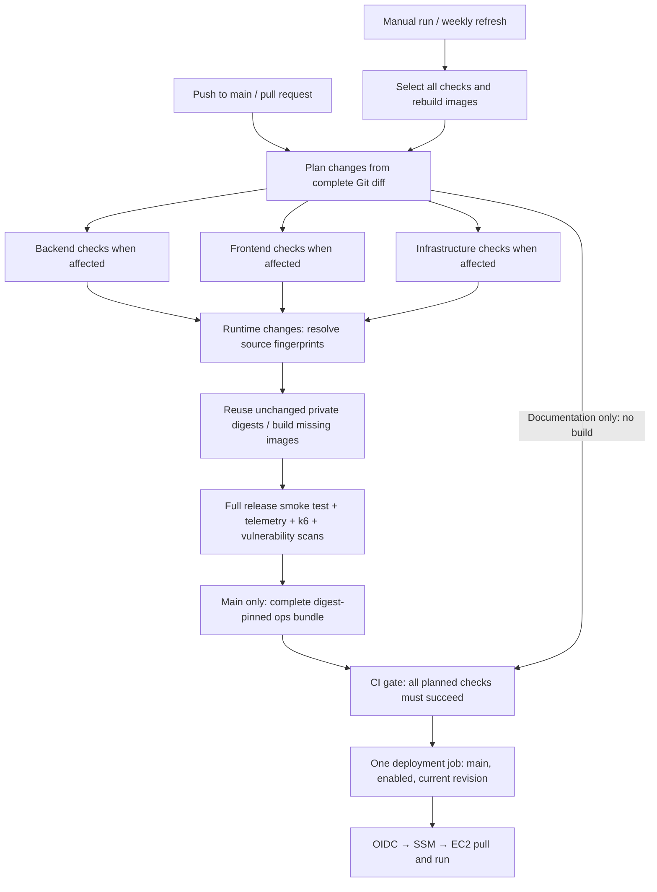

# Production deployment

This setup builds on GitHub-hosted runners, stores **private** images in GHCR, and deploys finished images over AWS Systems Manager. EC2 does not clone Git, install npm packages, or build React. No Kubernetes or S3 is required. Optional production observability uses one Alloy collector with Grafana Cloud; see [observability/README.md](observability/README.md) for activation.

## Architecture

Start with the [GitHub → AWS → Grafana Cloud flow and credential guide](../README.md#how-github-aws-and-grafana-cloud-work-together) for the full system diagram, an easy walkthrough of OIDC/SSM, and where each key-value setting belongs. The diagram below focuses on deploying and serving the application; the [observability guide](observability/README.md) expands telemetry collection and storage.



The backend and worker share a small runtime image with production dependencies and a generated Prisma client. A separate migration image contains Prisma CLI and seed tools. The frontend image contains Nginx and static files only. The tiny ops image transports the Compose manifest, scripts, and exact image digests without S3.

### Private registry package names

New releases use `ghcr.io/<owner>/<repository>-private-<kind>`, with `kind` equal to `backend`, `migration`, `frontend` or `ops`. For this repository, the package names begin with `url_shortner-system_desing-analytics-full_stack-private-`. Backend and worker share the backend image. All image tags, digest manifests, smoke checks and the deployment bundle use the same generated prefix.

This separates production publishing from older packages that were made public. GitHub does not support changing a public package back to private. The workflow checks the new package names before publishing and verifies all four are private afterward; it does not delete or change old public packages. Review old public packages separately if they should no longer be distributed. The EC2 pull-token account must have read access to the four new packages; the token remains in Parameter Store. No hardcoded image-name change is required on EC2 because releases carry exact image references.

Docker login, Buildx setup and build/push actions use SHA-pinned Node.js 24 releases. This action runtime is separate from the Node.js version used inside application images.

If a package has become public, do not keep renaming and rebuilding application images. Use the [controlled private-package setup](#recover-from-a-public-package-conflict) below first. `GHCR_PACKAGE_NAMESPACE` is an optional repository variable containing only the package prefix, without `ghcr.io`, username or image suffix. All four release images consistently use the chosen prefix. The original namespace remains the default when the variable is absent. No EC2 image-name edit is needed because the complete release manifest contains exact references.

### Recover from a public package conflict

The error `visibility='public', expected private` is a registry configuration failure. A public package cannot be made private again. The source-repository access inheritance checkbox does not itself prove why a package became public; it controls permissions, not visibility. Keep existing public packages unchanged while creating and verifying separate private packages.

1. On the repository owner's GitHub account, create a short-lived **classic PAT** with `write:packages` (and its included read permission). Avoid unnecessary `repo` and `delete:packages` scopes. This is a one-time setup token; do not put it in AWS, commit it or replace EC2's read-only token with it.
2. Start Docker Desktop. From the repository root on your laptop, run:

   ```powershell
   node infrastructure/scripts/bootstrap-ghcr.mjs --repository PrashantBhushan-repo/url_shortner-system_desing-analytics-full_stack
   ```

   Paste the setup PAT when prompted; input is hidden. The script chooses a random unused prefix (or accepts `--namespace YOUR_UNUSED_PREFIX`). It verifies the token owner's identity and all four candidate names before publishing. It pushes only an empty `scratch` placeholder, with no application files or source-repository label, then confirms each package is private. Temporary Docker credentials are removed on success or failure; your normal Docker login is not changed. Keep the printed namespace if you need to resume with `--namespace` after an interruption.

3. Follow the four package links printed by the script. In **each package → Package settings → Manage Actions access**, add this repository and select **Write**. Keep inherited access disabled; a repository source link can be added after the first private publication without opting into inherited permissions. Leave visibility **Private**. Explicit Actions access is what allows normal CI to publish using its built-in `GITHUB_TOKEN`.
4. In **Repository Settings → Secrets and variables → Actions → Variables**, set `GHCR_PACKAGE_NAMESPACE` to the exact prefix printed by the script. Do not reuse the public `pburls-production-v2` prefix. Confirm the owner of EC2's existing read-only pull token can read all four private packages.
5. Revoke the setup PAT after granting Actions access. Start a **new** `Test, Build and Deploy` run on `main`. Do not rerun an old workflow revision when applying workflow changes. Normal publishing continues with `GITHUB_TOKEN`, not the setup PAT.

The workflow now verifies each runtime package immediately after its build/push, before the long smoke tests, and verifies all four packages after publishing the ops bundle. Privacy remains a deployment requirement. If the local setup itself reports public visibility after publication, stop and inspect account/package settings or contact GitHub support; it deliberately refuses to continue. Creating placeholders does not deploy application code or modify AWS resources, GitHub variables, repository access settings, old packages or existing versions.

References: [GHCR authentication and private-by-default first publication](https://docs.github.com/en/packages/working-with-a-github-packages-registry/working-with-the-container-registry), [package permissions, inheritance and Actions access](https://docs.github.com/en/packages/learn-github-packages/configuring-a-packages-access-control-and-visibility).

Only ports 80 and 443 are public. PostgreSQL, Redis, backend, metrics, and worker have no published production ports. Nginx overwrites forwarded headers; Express trusts only the configured Docker subnet. The backend still has outbound access for email, OAuth, payments, and link checks.

## How the pipeline selects work

`ci-cd.yml` is the only automatic coordinator. `backend.yml`, `frontend.yml` and `infrastructure.yml` are reusable validation workflows, not independent deployments. This prevents different workflows from deploying incomplete image combinations or overwriting each other's release.



| Change | Component checks | Release verification |
| --- | --- | --- |
| Known documentation paths only | Planner unit tests and CI gate | No build or deploy |
| `frontend/**` | Frontend tests, lint and build | Complete release smoke and scans; unchanged backend/migration images reused |
| `backend/**` | Backend plus frontend Socket.IO contract checks | Complete release smoke and scans; unchanged frontend image reused |
| Executable `infrastructure/**` | Shell, workflows, CloudFormation, Alloy, dashboards and benchmark harness | Complete release smoke and scans; unchanged application images reused |
| Workflows, shared settings or unknown paths | All component checks | Complete release verification |
| Manual run / weekly schedule | All component checks | Rebuild with current base images and run all verification |

Pushes compare with the last successful push pipeline on `main`, so failed or superseded pushes do not hide unverified changes. Pull requests compare against their target base SHA. The planner uses a complete local Git diff rather than GitHub's limited path list. Missing history or an unavailable history API selects full checks and a refresh. The planner's own unit tests run even for documentation changes.

Application image fingerprints include the committed component tree, Node version and build policy. On `main`, existing private source tags resolve to immutable digests; missing images are built with BuildKit caching. On the first run all images build. Pull requests build locally without private registry credentials and never publish or deploy. Every executable release tests the selected images together, including reused images, and scans runtime images for fixable high/critical vulnerabilities. Source tags are cache references; the release manifest and EC2 deployment use exact digests. The ops bundle always includes all image references.

Weekly runs refresh base images and verify the release without deploying. A manual run also refreshes everything and can deploy when enabled. If a scan finds a fixed base-image vulnerability between weekly refreshes, use a manual run to rebuild immediately. Documentation-only pushes do not publish images.

Require **`CI gate`** in branch protection. Production deployment additionally requires `PROD_DEPLOY_ENABLED=true`, the `production` environment and a successful verified release. Set the enable flag as a **repository variable**, since the job condition is evaluated before entering that environment. Deployment and rollback share a concurrency group; an active deployment is not interrupted. Before sending SSM commands, deployment compares its commit with the tip of `main` and skips releases superseded by executable changes. A newer documentation-only commit still allows the verified runtime release to deploy. EC2's host lock also serializes deployment scripts. Changing `main` during an already-running deployment can still briefly leave the preceding release live until the next verified deployment completes.

GitHub artifacts retain smoke/measurement/security diagnostics for 14 days and release manifests for 30 days. Runtime secrets stay in Parameter Store; neither these artifacts nor the images should contain production `.env` files. The manual Grafana provisioning and rollback workflows remain separate operations.

## One-time setup

### Deployment region: ap-southeast-2 (Sydney)

Your existing production instance and data volume are in **`ap-southeast-2` (Sydney)**. Set GitHub's `AWS_REGION` variable to `ap-southeast-2`. Deployment and rollback pass the selected region through to SSM and host scripts; Sydney is the default when no region is configured. Check repository and `production` environment variables for conflicting overrides.

Use the EC2 instance, VPC/subnet, data EBS volume, Elastic IP and SSM parameters in the same selected region, with the data volume and instance in the same availability zone. Changing a variable does not move AWS resources. IAM roles and OIDC providers are global, but their policies may reference regional resources. Another region is supported when all regional resources and GitHub settings are configured consistently.

In CloudShell, select Sydney and set:

```bash
export AWS_REGION=ap-southeast-2
export AWS_DEFAULT_REGION=ap-southeast-2
export AWS_PAGER=""
```

When deploying the uploaded template, pass `--region "$AWS_REGION"` to `aws cloudformation deploy`. Supply the actual VPC, public subnet and matching availability zone from that region. An existing failed stack in another region is a separate resource and is not repaired by switching regions.

Grafana Cloud's OTLP endpoint belongs to the Grafana stack and can be in a different region; retain the exact endpoint Grafana supplies. Changing AWS regions does not resolve an organization-level IAM/OIDC explicit deny.

### 1. Provision AWS resources

Use `aws/stack.yml` in CloudFormation, or adapt its settings to an existing EC2 instance. Review the template before creating resources; running it creates billable AWS infrastructure.

The template uses an existing VPC and **public subnet** with an internet-gateway route. Select the same availability zone for the subnet and data volume. It creates:

- Ubuntu 24.04 x86_64 EC2; start with the size appropriate to your measured traffic.
- A 30 GiB encrypted root volume and separate configurable encrypted gp3 data volume.
- A retained data volume, termination protection, and Elastic IP.
- Ingress on 80/443 only; Systems Manager replaces public SSH.
- An EC2 IAM role for SSM and the application's Parameter Store prefix.
- A GitHub OIDC deployment role restricted to this repository's `production` environment and this EC2 instance.

If your AWS account already has the GitHub OIDC provider, pass its ARN to avoid creating a duplicate. The template creates no VPC, NAT gateway, load balancer, RDS, Redis service, or S3 bucket.

Record the stack outputs: instance ID, data volume ID, Elastic IP, and deployment-role ARN. Wait until the instance is **Online** in Systems Manager. The official Ubuntu AWS image includes the SSM agent; check its installation/connectivity if it does not appear.

### 2. Point the domain at EC2

At GoDaddy, create the hostname's **A record** pointing to the Elastic IP. Remove conflicting records. Do not add an AAAA record unless you separately configure IPv6. If a CAA record exists, it must permit Let's Encrypt.

This configuration handles one canonical hostname. Add other hostnames, certificates, and redirects explicitly later. DNS must resolve publicly and ports 80/443 must be reachable before the first certificate can be issued. Port 80 remains open for ACME renewal and redirects other traffic to HTTPS.

### 3. Store private runtime configuration

Prepare a private production env file using `backend/.env.production.example`. Fill in:

- `DOMAIN`, `BASE_URL`, `CLIENT_URL`, and `LETSENCRYPT_EMAIL`.
- Unique database credentials and matching URL (`db:5432` inside Docker).
- A unique random JWT secret of at least 32 characters.
- SMTP/payment/OAuth credentials for the integrations you enable. OAuth callback URLs must match provider registrations.
- `ALLOW_FORMAT_DATA_VOLUME=true` **only for initial setup of the new blank volume**. Change back to false afterward.

The supplied stack records the volume ID in Parameter Store; leave `DATA_VOLUME_ID` blank to use it. For an existing EC2 host, supply the attached data volume's ID explicitly. Never point it at your operating-system disk. The installer matches the NVMe serial to that volume ID, refuses the root disk, and formats only an entirely blank unpartitioned volume when explicitly enabled.

The production Compose file sets proxy trust to `APP_SUBNET`, default `172.30.50.0/24`; choose a nonconflicting subnet if your network already uses it. Runtime credentials are injected, never baked into an image.

Upload the env file to Parameter Store as a **SecureString** (standard tier limit is 4 KiB; use advanced tier for a larger value):

```bash
aws ssm put-parameter --name /pburls/production/runtime-env \
  --type SecureString --value file://production.env --overwrite --region "$AWS_REGION"
```

Use the default SSM KMS key with the supplied IAM policy. If you choose your own KMS key, add an appropriately scoped `kms:Decrypt` permission to the EC2 role. Restrict local file permissions and do not commit the real file. This implementation expects single-line values; single-quote passwords containing `$` or `#` to preserve literal values consistently with Compose.

Create a GitHub personal access token (classic) with **read:packages**, owned by an account that can read all four private packages. Authorize organization SSO if needed. Store it as another SecureString:

```bash
# Put the token in a protected file without a trailing newline; don't paste it into shell history.
aws ssm put-parameter --name /pburls/production/ghcr-token \
  --type SecureString --value file://ghcr-token.txt --overwrite --region "$AWS_REGION"
```

GitHub Actions publishes with its built-in `GITHUB_TOKEN`; EC2's separate token only pulls. The token is fetched at deployment time and Docker's credentials are root-readable under `/etc/pburls/docker`. Rotate it before expiration. GitHub packages should remain **Private** and linked to this repository; never make them public to resolve an authentication error.

### 4. Configure GitHub once

Create the GitHub `production` environment and limit its deployment branches to `main`. The OIDC role relies on this restriction. Required reviewers are optional if your GitHub plan supports them.

Repository variables:

| Variable | Value |
| --- | --- |
| `AWS_REGION` | `ap-southeast-2` (Sydney, matching the existing instance) |
| `EC2_INSTANCE_ID` | Stack instance output |
| `AWS_DEPLOY_ROLE_ARN` | Stack role output |
| `GHCR_PULL_USERNAME` | Account that owns the read-only package token |
| `PARAMETER_PREFIX` | `/pburls/production` unless customized |
| `PROD_DEPLOY_ENABLED` | `false` during setup; `true` when ready |

You can automate this with GitHub CLI from your workstation/CloudShell:

```bash
gh auth login
export AWS_REGION=ap-southeast-2
export EC2_INSTANCE_ID=YOUR_INSTANCE_ID
export AWS_DEPLOY_ROLE_ARN=YOUR_ROLE_ARN
export GHCR_PULL_USERNAME=YOUR_GITHUB_USERNAME
bash infrastructure/scripts/configure-github.sh OWNER/REPOSITORY
```

This script does not set or upload application secrets. If environment policies are unavailable for your private repository's GitHub plan, resolve that before enabling the environment-based OIDC deployment.

Allow Actions to write packages. No Docker Hub password, AWS access key, EC2 private SSH key, or application secret belongs in the workflow. In branch protection or repository rulesets, require **`CI gate`**. Remove obsolete required check names from the previous pipeline: component jobs intentionally skip when unaffected, while this gate always reports and rejects failed or unexpectedly skipped checks.

If deployment reports `Missing or invalid EC2_INSTANCE_ID`, open **Repository Settings → Secrets and variables → Actions → Variables → Repository variables** and create or edit `EC2_INSTANCE_ID`. Its value is the EC2 instance ID from the stack output, such as `i-0123456789abcdef0`, with no quotes, ARN or IP address. This value is not read from `.env`, Parameter Store or GitHub Secrets. Verify that `AWS_REGION` matches the instance's region and that the `production` environment does not contain a stale same-named override. Set `GHCR_PULL_USERNAME` at repository scope too. The planner now validates these repository variables before production builds when deployment is enabled; deployment and rollback validate the effective target again before AWS authentication. Missing configuration never falls back to a hardcoded instance. After correcting variables, start a new run on `main`.

### 5. First release

Commit the reviewed application and DevOps changes and push to `main`. The workflow tests and builds before any deployment. With deployment disabled, it still publishes private images and a digest-pinned ops bundle. GitHub's Actions summary and release artifact identify the built version.

After DNS and Parameter Store are ready:

```bash
gh variable set PROD_DEPLOY_ENABLED --repo OWNER/REPOSITORY --body true
gh workflow run ci-cd.yml --repo OWNER/REPOSITORY --ref main
```

The first deployment installs Docker Engine/Compose and AWS CLI once, mounts EBS, validates runtime settings, starts the database/Redis, migrates, seeds plans if the plan table is empty, and starts the app. It serves only ACME and a health endpoint over HTTP until a real certificate is issued. Failed certificate issuance leaves initial setup unavailable rather than publishing the app over plaintext.

Admin creation is a deliberate one-time operation, not part of every release. Set all three admin seed variables, then use a root SSM session:

```bash
source /opt/pburls/current/infrastructure/scripts/common.sh
load_release /opt/pburls/current
dc run --rm --no-deps migrate node prisma/seedAdmin.js
```

Clear the admin seed variables from Parameter Store afterward and deploy the config change. The seed updates an existing administrator's credentials, so do not schedule it automatically.

## Every later release

1. Run isolated unit/integration tests and validate shell/Python/AWS configuration.
2. Build cached images on GitHub with locked npm dependencies and no application secrets.
3. Test the actual images with a disposable PostgreSQL/Redis stack, self-signed **test-only** HTTPS, routing checks, and a real redirect → BullMQ → worker → database click.
4. Scan runtime images; fixable high/critical vulnerabilities block deployment.
5. Publish SBOM/provenance and immutable digests; deliver the deployment bundle through private GHCR.
6. Assume the scoped AWS role using OIDC and issue an SSM command; wait for its result.
7. On EC2, pull images, validate production settings and storage, and take an optional local pre-migration dump.
8. Run migration once, update backend/worker/frontend, verify readiness and HTTPS, and record the current/previous release.

Normal application releases do not recreate existing PostgreSQL or Redis containers. Infrastructure-image upgrades require a separate maintenance operation. Existing images are used on reboot; startup does not rebuild or download dependencies. A Docker/systemd dependency prevents containers starting on an unmounted data disk.

Dependency installation layers survive ordinary source changes. npm cache mounts speed local rebuilds; GitHub's external BuildKit cache preserves layers between runners. BuildKit cache mounts themselves are not automatically exported to GitHub cache. Actions are pinned to verified commit SHAs, and Dependabot proposes updates. Weekly scheduled runs build/test refreshed bases but do not automatically deploy them.

Frontend lint is blocking and requires zero errors and warnings. Tests, configuration checks, builds, vulnerability scans, and container smoke checks are also blocking. Workflow runners are pinned to Ubuntu 24.04 to avoid unexpected changes when GitHub updates its `ubuntu-latest` image.

## Nginx behavior

- Static React files, SPA fallback, immutable caching for hashed `/assets/`, and revalidation for HTML.
- Gzip, upstream keepalive, automatic Docker DNS re-resolution after backend replacement.
- TLS 1.2/1.3, HTTP/2, session caching, disabled session tickets, and initially one-day HSTS.
- Scheduled Let's Encrypt renewal twice daily; Nginx configuration validation and graceful reload.
- `/api/` and `/r/` reverse proxy, Socket.IO upgrades, unbuffered MCP streaming.
- No proxy cache for APIs/redirects; no accidental loss of analytics through cached redirects.
- Request/body/time limits, forwarded-header replacement, hidden-file blocking, internal readiness/metrics blocked at the public edge.
- JSON access logs exclude query strings to keep OAuth codes out of logs; Docker rotates logs.

Rate limits remain in the application; this avoids imposing a second arbitrary edge limit on legitimate redirects. Nginx can load-balance additional backends later. This single EC2 setup provides no high availability or guaranteed zero-downtime releases; app replacement can briefly interrupt requests/WebSockets. Browser performance/RUM and a full telemetry backend remain deferred.

## Rollback and data protection

Run the separate **Roll back production application** workflow on `main`. The host retains the previous manifest/images and switches the application back. Automatic failed-release recovery also attempts to restore the previous application images.

Database migrations are **not reversed**. Use additive, backward-compatible migrations; incompatible changes may require a forward fix. Rollback does not restore old runtime secrets, database contents, or cloud resources.

There are **no S3 backups**. By default, deployment retains the three newest compressed PostgreSQL dumps in `/srv/pburls-data/migration-backups`; they are only a local recovery aid. Set `PRE_MIGRATION_BACKUP=false` if you explicitly want to skip them. A failed/empty backup stops the deployment. Redis uses AOF/every-second syncing and no eviction; abrupt failure can still lose the newest writes.

EBS survives EC2 stop/start; the retained data volume also survives stack deletion/replacement, subject to AWS lifecycle and manual actions. EBS is not an independent backup, and these local dumps do not protect against losing the data volume. Stopping EC2 takes the whole website offline; EBS and Elastic IP charges can continue.

Do not run production `down -v`, volume deletion, broad Docker prune commands, or disk formatting. The deployment never performs these. Image cleanup is deliberately manual: retain current/previous images and ensure root/data disks have free space. Old release directories are small; unused image layers can accumulate over time.

## Operations

Connect through Systems Manager as root, then:

```bash
source /opt/pburls/current/infrastructure/scripts/common.sh
load_release /opt/pburls/current
dc ps
dc logs --tail=100 backend worker frontend
docker stats --no-stream
df -h / /srv/pburls-data
systemctl list-timers pburls-renew.timer
journalctl -u pburls-renew.service --since today
```

Never publish resolved `docker compose config` output or Parameter Store values. `config --quiet` checks syntax without displaying secrets. Deployment output is recorded in GitHub/SSM; certificate-renewal failures are in the systemd journal. Add external uptime/expiry alerts when monitoring is enabled.

Changes to runtime Parameter Store values take effect on the next deployment. Nginx certificate files and renewal metadata live on EBS. Existing DNS and certificate settings must be deliberately updated if you change the canonical domain.

References: [Docker caching](https://docs.docker.com/build/ci/github-actions/cache/), [GHCR authentication](https://docs.github.com/en/packages/working-with-a-github-packages-registry/working-with-the-container-registry), [SSM Run Command](https://docs.aws.amazon.com/systems-manager/latest/userguide/run-command.html), [Certbot renewal](https://eff-certbot.readthedocs.io/en/stable/using.html#renewing-certificates).
