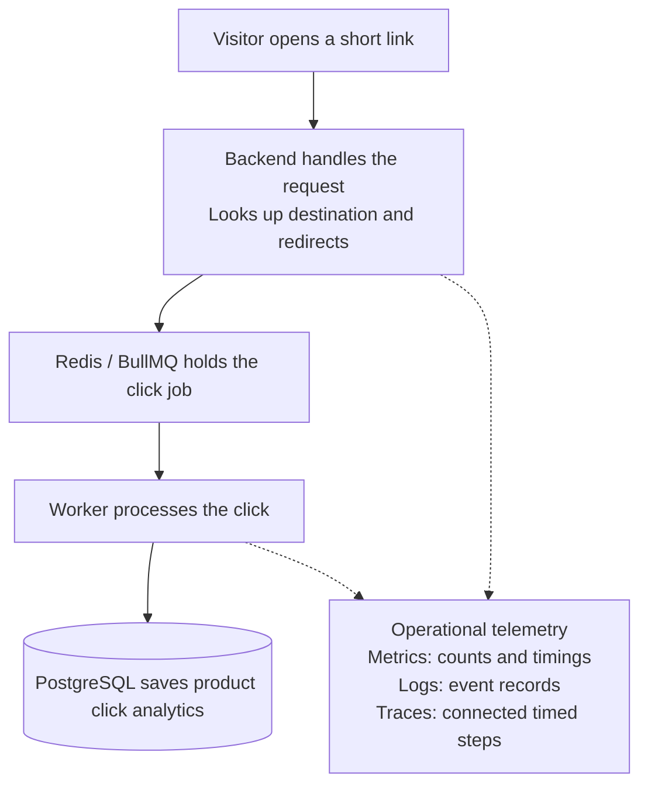
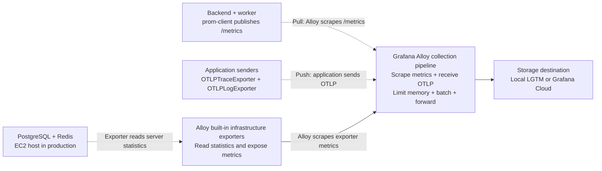
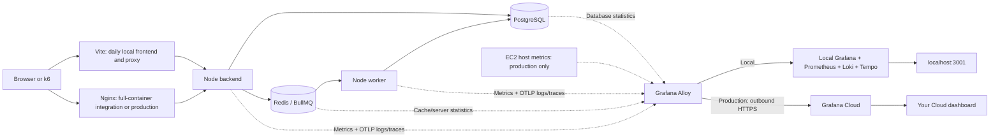
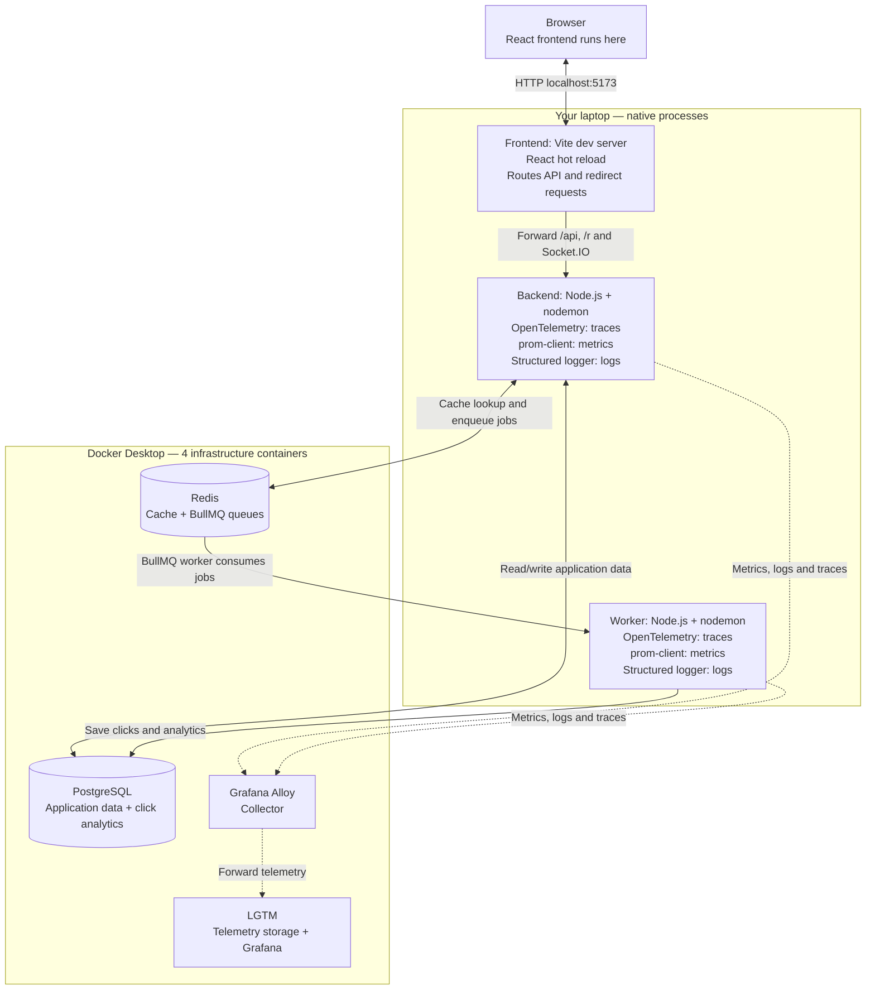
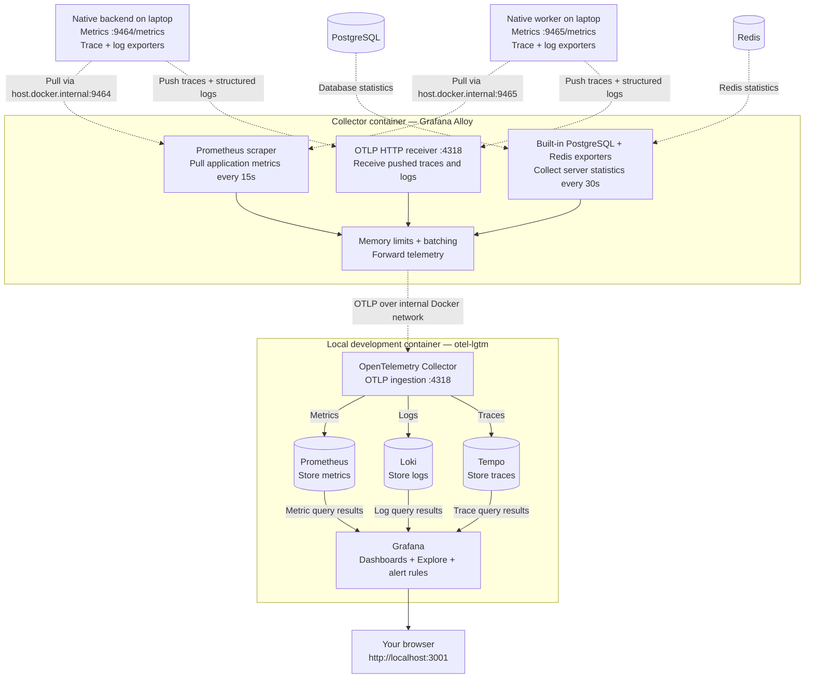
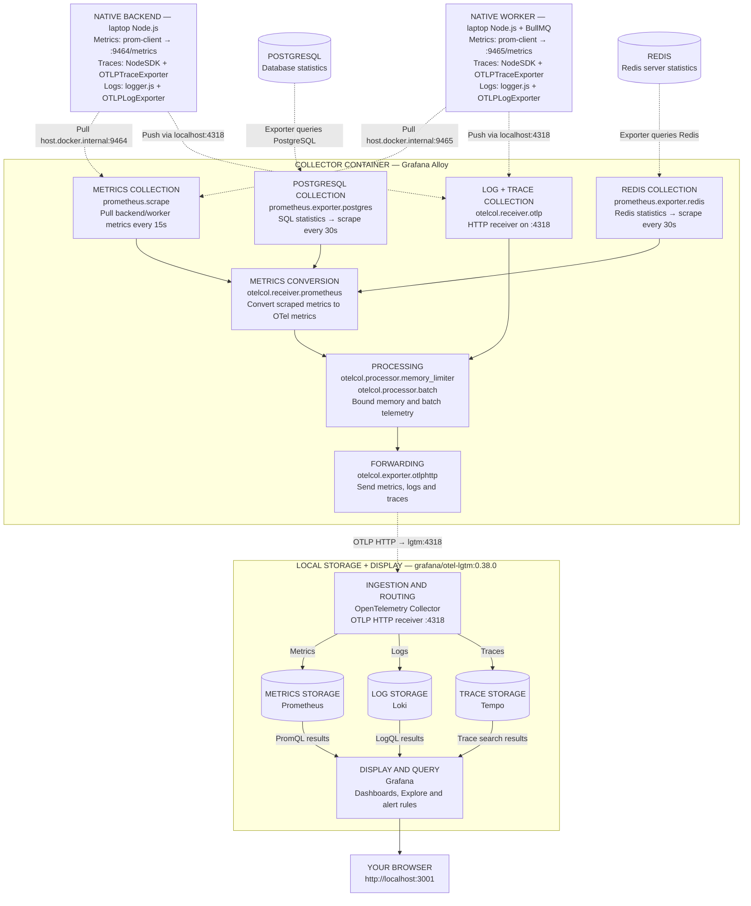
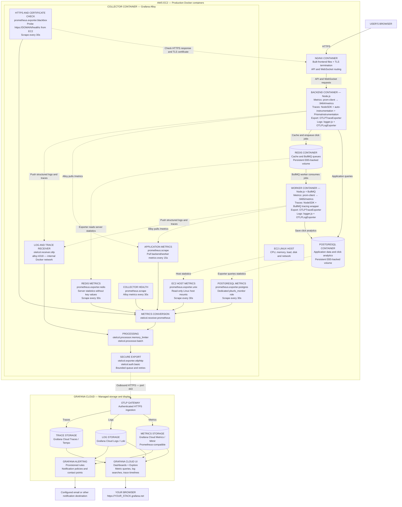
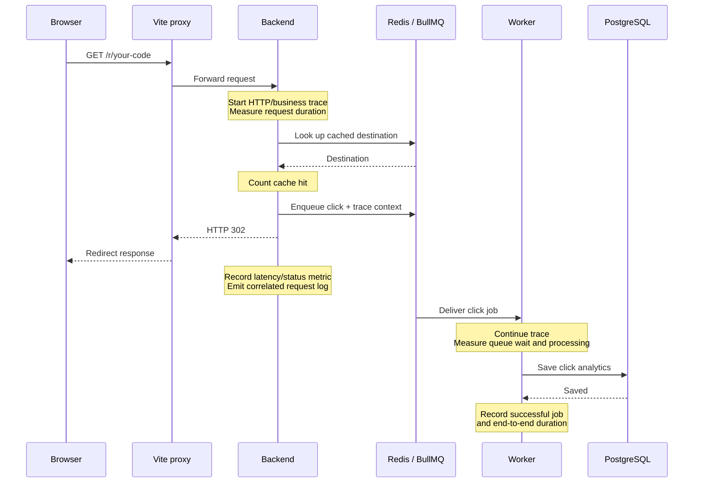

# Observability: understand, collect, view and compare

Use **OpenTelemetry + Prometheus metrics + Grafana**. The application instrumentation is the same in both environments. Local storage runs on your computer; production storage runs in Grafana Cloud.

| | Local development | Production |
|---|---|---|
| Collector | Grafana Alloy | Grafana Alloy, digest pinned by CI |
| Metrics, logs, traces storage | Grafana `otel-lgtm` development bundle | Grafana Cloud |
| View results | `http://localhost:3001` | Your Grafana Cloud URL |
| Trace sampling | 100% of new root traces by default; parent decisions propagate | 10% of new root traces by default; parent decisions propagate |
| Successful request logs | 100% | 10% by default; server errors always recorded |
| Application metrics | Every completed request/job, independently of sampling | Same |
| Database/Redis metrics | Alloy built-in exporters | Same; dedicated `pg_monitor` database role |
| Host metrics | Application processes; Docker Desktop host panels intentionally empty | EC2 CPU, memory, disk, filesystem and network |

The local all-in-one bundle is intended for development, not production. Production adds one collector container; it does not run a Grafana/Loki/Tempo/Prometheus storage cluster on EC2. GitHub builds, tests and publishes application images. Alloy uses an official upstream image; no custom observability image needs maintaining.

## Start here: what each signal means

Observability helps you answer three questions: **Is the application healthy? What happened? Where did time go?**

| Signal | Easy way to understand it | Example question |
|---|---|---|
| Metrics | A report card: numbers measured over time | How many requests failed? What is the p95 latency? |
| Logs | A diary: timestamped records of events | What error happened during this request? |
| Traces | A journey map: timed steps across services | Was the delay in the backend, queue or database? |

**Grafana Alloy is the collector and delivery service.** It gathers telemetry, batches it and forwards it. It is not the main historical database or dashboard. **OpenTelemetry** is the instrumentation toolkit and shared telemetry format; **OTLP** is the protocol used to deliver that telemetry. **Grafana** is where you inspect the stored results.

Libraries run inside the backend/worker processes. Alloy components run inside the Alloy container. The local LGTM bundle contains several storage/display tools in one container. In production, Grafana Cloud provides that storage/display layer.

## Architecture diagrams: read in this order

1. [The application journey and its signals](#diagram-1-the-application-journey-and-its-signals)
2. [Collection: pull versus push](#diagram-2-collection-pull-versus-push)
3. [Deployment overview: local and production](#diagram-3-deployment-overview-local-and-production)
4. [Local application and instrumentation](#diagram-4-local-application-and-instrumentation)
5. [Local telemetry: collection, storage and display](#diagram-5-local-telemetry-collection-storage-and-display)
6. [Exact local libraries and collector components](#diagram-6-exact-local-libraries-and-collector-components)
7. [Production: EC2 collection and Grafana Cloud](#diagram-7-production-ec2-collection-and-grafana-cloud)
8. [One redirect: request, trace and background job](#diagram-8-one-redirect-request-trace-and-background-job)

After the diagrams, follow [local startup](#1-start-locally), [production activation](#2-enable-production), or [performance experiments](#3-run-a-controlled-optimization-experiment).

Rectangles represent services or processing components; cylinders represent data stores. A subgraph groups components belonging to the same environment or container. Dashed arrows show telemetry data flowing toward collection; the labels identify whether Alloy pulls the data or the application pushes it. Arrows do not represent every network request/response.

### Diagram 1: The application journey and its signals

Opening a short link creates an HTTP request. The backend redirects the visitor and queues a click job. The worker later saves the click to PostgreSQL. Metrics, logs and traces describe that work; product click analytics and operational telemetry have different storage and purposes.



A successful redirect does not prove that the worker saved the click. Queue and worker measurements let you check the background work too.

### Diagram 2: Collection: pull versus push

**Pull** means Alloy regularly asks for numbers. **Push** means the application sends information to Alloy. An exporter can mean either an application sender or an infrastructure statistics adapter; the labels below show which role it performs.



Metric arrows show the direction of the returned telemetry, even when Alloy initiates the collection request.

### Diagram 3: Deployment overview: local and production

The application instrumentation stays the same. Daily development uses native Vite/backend/worker processes and four infrastructure containers. Nginx participates in the optional full-container integration workflow and production, where it terminates HTTPS.



### Diagram 4: Local application and instrumentation

This is the default local workflow. Only the four infrastructure services run in Docker; the frontend, backend and worker run on your laptop. React executes in the browser and Vite provides hot reload and request proxying.



Browser errors, Web Vitals and rendering performance are not currently instrumented. There is no Nginx in the default native workflow. In full-container mode, Nginx access/error logs remain available through Docker logs and are not forwarded to Loki. PostgreSQL and Redis do not contain Node telemetry libraries: Alloy reads their statistics through built-in exporters.

### Diagram 5: Local telemetry: collection, storage and display

Metrics are pulled from the application every 15 seconds. Logs and traces are pushed by application exporters. PostgreSQL and Redis statistics are scraped every 30 seconds. Grafana queries the stored data when you open dashboards or Explore.



### Diagram 6: Exact local libraries and collector components

This expands Diagram 5 with the names used in the implementation. Components inside the Alloy box run in one Alloy container. Prometheus, Loki, Tempo, Grafana and the ingestion collector run together in the local `otel-lgtm` development container.



Native application exporters send to `localhost:4318`, the port published by Alloy. Inside Docker, `lgtm:4318` receives Alloy's forwarded telemetry. In the optional full-container workflow, application exporters use `alloy:4318` instead. Alloy also collects its own operational metrics; those are omitted from the diagrams for readability.

| Library or code in backend/worker | Responsibility |
|---|---|
| `prom-client` | Application counters/histograms, Node process metrics and HTTP metrics endpoints. |
| `@opentelemetry/sdk-node` (`NodeSDK`) | Initialize tracing and connect instrumentation/exporters. |
| `@opentelemetry/auto-instrumentations-node` | Instrument supported HTTP, Express, `pg` and `ioredis` operations. |
| `@prisma/instrumentation` | Add Prisma database spans. |
| `bullmqTelemetry.js` + `@opentelemetry/api` | Carry trace context from backend through the queue to the worker; measure jobs. |
| `@opentelemetry/exporter-trace-otlp-proto` (`OTLPTraceExporter`) | Send traces to Alloy. |
| `logger.js` + `@opentelemetry/api-logs` | Create structured logs with trace context and allowed metadata. |
| `@opentelemetry/sdk-logs` | Batch log records before export. |
| `@opentelemetry/exporter-logs-otlp-proto` (`OTLPLogExporter`) | Send logs to Alloy. |
| `metrics.middleware.js`, `database.js`, `privacy.js` | Measure requests/database operations and filter exported trace attributes. |

| Tool inside the local LGTM container | Simple responsibility |
|---|---|
| OpenTelemetry Collector | Receive Alloy's OTLP telemetry and route it to the correct storage tool. |
| Prometheus | Store metrics; query numbers over time using PromQL. |
| Loki | Store logs; search them using LogQL. |
| Tempo | Store traces; inspect the timed steps of a request/job. |
| Grafana | Display dashboards, Explore results and alert rules using those data sources. |

### Diagram 7: Production: EC2 collection and Grafana Cloud

This is the configured production architecture **after enabling observability and supplying Grafana Cloud credentials**. Application services run in containers. EC2 runs one Alloy collector; telemetry storage and the Grafana UI run in Grafana Cloud. There is no production LGTM container on EC2.



| Component inside Alloy | Easy explanation |
|---|---|
| `prometheus.scrape` | Regularly collect numbers from a metrics endpoint. |
| `prometheus.exporter.postgres` / `prometheus.exporter.redis` | Translate database/cache statistics into metrics; these are not extra containers. |
| `prometheus.exporter.unix` | Read production Linux host CPU, memory, disk and network statistics. |
| `prometheus.exporter.blackbox` | Test the public HTTPS endpoint and certificate from EC2, not from worldwide locations. |
| `otelcol.receiver.prometheus` | Convert scraped Prometheus metrics into OpenTelemetry metrics. |
| `otelcol.receiver.otlp` | Receive logs and traces pushed by the application. |
| `otelcol.processor.memory_limiter` | Help keep pipeline memory within its configured budget. |
| `otelcol.processor.batch` | Pack telemetry into groups for more efficient sending. |
| `otelcol.exporter.otlphttp` + `otelcol.auth.basic` | Send authenticated telemetry to Cloud with a bounded queue and retries. |

**Security and operating limits:** Alloy's collection ports are not published on production EC2. Cloud write credentials belong to Alloy, not the application containers. A bounded in-memory export queue is not a permanent archive: prolonged outages or restarts can lose telemetry. Application and database persistence are separate from telemetry retention.

**Current coverage:** backend/worker metrics, supported instrumented traces, structured logs emitted through `logger.js`, database/cache statistics, and production host/HTTPS checks. Browser JavaScript errors and Web Vitals are not instrumented. Nginx access logs and arbitrary Docker console messages are not shipped to Loki. Trace/log correlation is available where records contain trace context; trace availability depends on sampling.

**GitHub's role:** Actions builds/tests/publishes images and deploys releases. A separate workflow can provision Grafana dashboards and rules. GitHub is not the live telemetry database or dashboard. Alert notifications require a configured contact point and notification policy.

Production defaults sample 10% of new root traces and 10% of successful HTTP request logs; inherited trace decisions propagate and server-error request logs are retained. Request/job metrics are collected independently of those sampling settings. Percentiles from histograms are estimates, not exact timings for every request. See the measurement guidance below before drawing optimization conclusions.

### Diagram 8: One redirect: request, trace and background job

A fast HTTP redirect and successful background analytics are separate outcomes. The trace context connects them so you can inspect both. This warm-cache example uses Vite's local proxy; the full-container workflow uses Nginx in the same position. A cache miss adds a database lookup before redirecting.



The worker runs asynchronously: it can begin before or after the browser receives the redirect. HTTP and job metrics cover every instrumented operation. Native development profiles sample new traces and successful-request logs at 100% by default; inherited trace sampling decisions still propagate.

| What you want to inspect | Where to look in Grafana |
|---|---|
| Request rates, latency, errors, cache hits, process CPU/memory | Application dashboard |
| Queue depth, failed attempts, processing/wait/end-to-end time | Workers dashboard |
| PostgreSQL and Redis statistics | Database, Redis and Host dashboard |
| Structured request/error/job logs | Explore → Loki |
| Connected request, cache, queue, worker and database spans | Explore → Tempo |

Host/EBS panels require the production Linux collector and are intentionally empty in local development. Continue below to start the stack, enable production or run a controlled experiment.

## 1. Start locally

Complete the root `.env` and native backend setup described in [ENVIRONMENT.md](../../ENVIRONMENT.md). From the repository root, start only PostgreSQL, Redis, Alloy and LGTM:

```powershell
node infrastructure/scripts/local.mjs up
```

Install dependencies once with `npm --prefix backend ci` and `npm --prefix frontend ci`. Run `npm --prefix backend run dev:setup` deliberately at initial setup or after schema changes: it generates Prisma, applies local migrations and seeds plans. Existing env files and database volumes are retained.

Start these in **two separate terminals**. The backend command starts both backend and worker with hot reload:

```powershell
npm --prefix backend run dev
```

```powershell
npm --prefix frontend run dev
```

Open **http://localhost:5173** for the frontend and **http://localhost:3001 → Dashboards → PBUrls** for Grafana. The backend listens on port 5000. Ctrl+C in the backend terminal stops both backend and worker. Stop existing standalone backend/worker processes before using the combined command; `dev:backend` and `worker:dev` remain available for running a single service. Backend/worker launchers apply distinct service names and metrics ports, enable local OTLP export, and prevent an automatically forked duplicate worker. No application images are built for this workflow. Use `npm --prefix backend run dev:check` to validate native settings without printing secrets.

For a seven-container integration check, stop all three native processes and run `node infrastructure/scripts/local.mjs --full-stack up`. The frontend then uses Nginx at port 3000. Only full-stack mode materializes source-only build contexts for OneDrive compatibility; `PBURLS_BUILD_CACHE` can place them on D:. Returning to default `up` stops any backend/worker/frontend containers before starting the four infrastructure services. The legacy `--observability` flag is accepted but no longer needed.

Initial startup downloads the observability images and can take several minutes. Allow several GB of Docker disk space and approximately 2–3 GiB of available RAM for the development bundle. These are planning allowances, not measured overhead guarantees.

Make some requests before expecting charts. Allow 30–60 seconds for metrics and traces to arrive. Dashboards contain:

- **Application:** RPS; p50/p95/p99; redirect latency; 4xx/5xx by route; cache hit ratio; CPU; resident memory; heap; event-loop delay; in-flight/aborted responses; database query duration; Node pg pool pressure; structured logs.
- **Workers:** waiting/active/delayed/retained jobs; successful and failed attempts; processing time; click queue wait and creation-to-success latency; queue collection health.
- **Database, Redis and Host:** database connections, transaction/rollback/deadlock/read counters; Redis memory, throughput, connections and evictions; production host disk, CPU, memory and network; collector failure counters.

Use **Explore → Tempo** to search a trace, and **Explore → Loki** for request/job logs. HTTP → Redis → queue producer → worker → database context propagates with W3C trace IDs. A trace can show the worker after the HTTP response finishes. Logs link to traces when the trace was sampled. Local datasource configuration provides trace-to-log navigation.

Optional: install alert rules locally as well:

```powershell
node infrastructure/observability/provision.mjs
```

This imports/updates the three dashboards and eleven alert rules. Alerts are visible in **Alerting**. File-provisioned local dashboards are regenerated from the checked-in JSON; edit their generator for durable changes.

Useful diagnostics:

```powershell
node infrastructure/scripts/local.mjs ps
node infrastructure/scripts/local.mjs logs --tail 100 alloy lgtm
```

Alloy's local diagnostics are at http://localhost:12345. Grafana and collector ports bind to loopback. Local Grafana allows anonymous administrator access, so keep those loopback bindings. No Docker socket is mounted.

Use Ctrl+C in each application terminal to stop the native processes. `node infrastructure/scripts/local.mjs stop` stops the four infrastructure services while retaining their data. `down` removes containers but retains named volumes. **Do not use `down -v` for your working database.**

`compose.native.yml` selects `host.docker.internal:9464` and `host.docker.internal:9465` for native metrics automatically. Database/Redis exporters keep Docker service addresses. Put custom `BACKEND_METRICS_PORT`/`WORKER_METRICS_PORT` values in the root `.env` so the collector and native launchers agree. Full-stack/production configurations retain `backend:9464` and `worker:9465` defaults. This native workflow targets Docker Desktop; a standalone Linux Docker Engine requires configuring an equivalent host gateway address.

## 2. Enable production

The production service remains opt-in until valid credentials are supplied.

1. Create a Grafana Cloud stack. In **Connections → OpenTelemetry**, obtain the OTLP gateway endpoint, numeric instance ID, and an access-policy token scoped to this stack with `metrics:write`, `logs:write`, and `traces:write`.
2. Copy `observability.env.example` to a private file. Fill in the Cloud values and a monitoring database password generated with `openssl rand -hex 32`. Store the whole file as an AWS SSM **SecureString** named `/pburls/production/observability-env`, using your configured prefix if different. Do not commit the file or paste credentials into a workflow.
3. Add these settings to the existing production **runtime-env** SecureString:

   ```dotenv
   OBSERVABILITY_ENABLED=true
   OBS_TRACE_SAMPLE_RATIO=0.1
   OBS_REQUEST_LOG_SAMPLE_RATIO=0.1
   ```

4. Deploy through the existing GitHub workflow. Deployment fetches and validates the separate observability secret, creates/updates the dedicated database monitoring role, validates the actual Alloy image configuration, and starts Alloy. Cloud credentials stay out of the backend and worker containers. On EC2 reboot, the existing startup service also starts Alloy.
5. Open your Grafana Cloud stack to view telemetry. No observability port is published on EC2, and the existing public Nginx routes continue blocking `/metrics` and `/ready`. Alloy sends telemetry over outbound HTTPS.
6. Import dashboards and alert rules from your computer once, or rerun this after dashboard changes. Use a separate **Grafana service-account token** with dashboard/folder and alert-rule provisioning permissions. The telemetry write token from step 1 cannot manage Grafana dashboards.

   ```powershell
   $env:GRAFANA_URL='https://YOUR_STACK.grafana.net'
   $env:GRAFANA_TOKEN='YOUR_PRIVATE_GRAFANA_SERVICE_ACCOUNT_TOKEN'
   $env:GRAFANA_PROMETHEUS_UID='YOUR_CLOUD_PROMETHEUS_DATASOURCE_UID'
   $env:GRAFANA_LOKI_UID='YOUR_CLOUD_LOKI_DATASOURCE_UID'
   $env:OBS_ENVIRONMENT='production'
   node infrastructure/observability/provision.mjs
   Remove-Item Env:GRAFANA_TOKEN
   ```

   Find the datasource UIDs in Grafana's datasource settings/URL. The script selects the Cloud metrics and logs datasources automatically. Cloud traces appear in its Tempo datasource; enable trace/log links in that datasource if your Cloud stack has not configured them already.

   Alternatively, run provisioning entirely on GitHub: set production environment variables `GRAFANA_URL`, `GRAFANA_PROMETHEUS_UID`, `GRAFANA_LOKI_UID`, and the secret `GRAFANA_SERVICE_ACCOUNT_TOKEN`. Run the **Provision observability dashboards and alerts** workflow from `main`. It performs the same operation on a GitHub-hosted runner, with no work on EC2. Re-run it after dashboard/rule updates.

7. In Grafana **Alerting → Contact points**, configure your email or other destination, test it, then add a **Notification policy** matching `application=pburls`. Alerts do not notify anyone until you configure this destination. Initial rules cover app scrape failures, missing telemetry, 5xx rate, slow redirects, click backlog, failed worker attempts, PostgreSQL/Redis reachability, low EBS space, public HTTPS failures and certificate expiry. Tune the initial thresholds from real measurements; they are not an established service-level objective.

The script is repeatable and overwrites the PBUrls dashboards/rules it owns. Export UI changes before rerunning it if you want to preserve them. It does not create or contact notification recipients.

Manual EC2 setup without the SSM dispatcher is also possible: place the private file at `/etc/pburls/observability.env`, owned by root with mode `600`, and run `bash /opt/pburls/current/infrastructure/scripts/observability.sh` as root after enabling the flag in runtime.env. The normal dispatcher uses SSM instead.

To disable collection, set `OBSERVABILITY_ENABLED=false`, deploy again, and stop the old collector with `docker stop pburls-alloy-1`. The application will resume with export disabled. Retain the Cloud history for comparisons.

### Tune alerts without adding noise

The same eleven rule identities are updated in place by `provision.mjs`; changing thresholds does not create duplicate alerts. The defaults live in [alert-thresholds.json](alert-thresholds.json), and the queries/annotations in [alert-rules.mjs](alert-rules.mjs). These are initial operating budgets, not values proven by production measurements.

| Rule | Default behaviour |
|---|---|
| HTTP errors | More than 1% 5xx, **at least 100 requests and 5 server errors over 10 minutes**, sustained for 5 minutes. One failed request during very low traffic does not trigger the ratio alert. Availability/HTTPS alerts remain separate. |
| Redirect latency | p95 above 250 ms with **at least 100 redirect observations over 10 minutes**, sustained for 5 minutes. Sparse traffic still appears on dashboards but does not produce a low-confidence percentile alert. |
| Click backlog/delay | More than 100 waiting clicks **or** the head waiting click was created over 60 seconds ago, sustained for 2 minutes. A small stalled queue can therefore alert too. |
| Worker failures | At least one job in BullMQ's **failed state**, sustained for 5 minutes, grouped by queue. Intermediate retry attempts are still counted/logged but do not directly trigger this rule. Jobs retained in failed state from older releases still require investigation and deliberate retry/removal; this is not a new-failures-only counter. |

Queue alerts require successful queue statistics polling. They do not interpret a failed read as a healthy empty queue. Queue age adds just one bounded `getWaiting(0, 0)` read for a nonempty FIFO click queue per 15-second poll. It uses the returned job's original creation timestamp, includes previous retry time, and is not an exact minimum timestamp over every queued job. Empty queues export zero; no job IDs, payloads or timestamps become metric labels. A running job that hangs after leaving the waiting list is not detected by this waiting-age signal.

To tune from measurements, compare representative idle and normal-load periods, investigate traces for slow paths, and select an acceptable user-facing latency/analytics delay with a margin. Do not automatically raise thresholds merely because the application became slower. Sparse traffic is intentionally excluded from the ratio/percentile alerts; it is not proof of good health.

For durable project-wide changes, edit `alert-thresholds.json` and rerun provisioning. For per-environment tuning, optionally set the **GitHub `production` environment variable** `PBURLS_ALERT_THRESHOLDS_JSON` to a partial JSON object, for example:

```json
{"httpMinRequests":50,"httpMinErrors":3,"redirectMinRequests":50,"redirectP95Seconds":0.4,"clickQueueWaitSeconds":90}
```

Only set those example values after choosing them from your own measurements. Omitted keys keep checked-in defaults. Unknown keys, nonnumeric/nonpositive values, invalid counts, invalid error ratios and windows outside 5–60 minutes are rejected before any Grafana writes. The variable changes provisioning only; it is not an EC2 runtime secret. Direct local provisioning accepts the same JSON in the shell environment. Queue age requires deploying the updated backend/worker instrumentation before provisioning its updated rule. Contact points and notification policies are retained; they are not created by provisioning.

## 3. Run a controlled optimization experiment

Create an ordinary **disposable test link** through the application. Use an unprotected, active redirect whose destination you control. The test does not follow the destination. It creates real click analytics and queue jobs, so use a test account and preferably a staging environment.

Start with this low-rate functional baseline:

```powershell
$env:BENCHMARK_NOTES='Baseline; same dataset and machine; warm cache; describe the tested change'
node infrastructure/observability/benchmark.mjs run baseline http://localhost:5173/r/YOUR_TEST_CODE 1 60
```

This uses the official k6 image, warms the redirect for 10 seconds, then starts one request per second for 60 seconds. It saves:

- `k6.json`: the original client measurements and threshold results.
- `record.json`: revision, dirty-working-tree flag, test configuration, environment notes, request count, achieved RPS, p50/p95/p99, failure fraction, dropped iterations, and available server measurement summaries.
- `server-metrics.json`: raw time-stamped server samples and sampled min/max/mean, with missing/error series explicitly identified.

Results live under `.artifacts/observability/` and are ignored by Git. `passed=false` and a nonzero exit code indicate a threshold failure; the report is retained. Initial budgets are p95 < 250 ms, failure fraction < 1%, and no dropped measured iterations. A failed redirect includes 4xx/429/5xx and network failures, not just server errors.

The existing redirect rate limit is **100 per minute per client by default**. Keep it enabled in production. Before testing local throughput above this limit, explicitly raise `REDIRECT_RATE_LIMIT_MAX` in your private local root `.env`, recreate the backend, and record that setting in `BENCHMARK_NOTES`. Allow the existing rate-limit window to expire between low-rate runs. A 429 is a real limit response, not proof that the database or Node server is slow.

For a local capacity experiment after adjusting the local limit, use the same command with e.g. `10 120` (10 RPS for 120 seconds). Increase gradually, observe resource/queue saturation, and stop when errors or queue backlog grow. Never infer maximum capacity from one low-rate run.

Apply **one change**, rerun with the same rate, duration, machine/instance, dataset, cache state, worker concurrency, sampling, limits and background traffic:

```powershell
node infrastructure/observability/benchmark.mjs run candidate http://localhost:5173/r/YOUR_TEST_CODE 1 60
node infrastructure/observability/benchmark.mjs compare PATH_TO_BASELINE/record.json PATH_TO_CANDIDATE/record.json
```

Run at least three repetitions and compare typical results, not the single best run. Keep notes about dataset size, EC2 type, region, connection limits, cache warm/cold state and traffic. Treat a higher RPS as useful only if latency, errors and queue drain time remain acceptable. Let the click queue drain after each experiment and check that recorded clicks persisted; an HTTP 302 alone does not prove successful analytics ingestion.

For remote testing, explicitly set `ALLOW_REMOTE_LOAD_TEST=true`. The runner caps remote tests at 20 RPS and 10 minutes; use a staging instance for larger tests. Run the load generator away from EC2 so it does not steal the server's CPU. To save Cloud metrics, configure a separate query URL and **metrics read** credential:

```powershell
$env:PROMETHEUS_QUERY_URL='https://YOUR_PROMETHEUS_HOST/api/prom/api/v1/query_range'
$env:PROMETHEUS_USERNAME='YOUR_METRICS_INSTANCE_ID'
$env:PROMETHEUS_READ_TOKEN='YOUR_METRICS_READ_TOKEN'
$env:ALLOW_REMOTE_LOAD_TEST='true'
node infrastructure/observability/benchmark.mjs run staging https://YOUR_DOMAIN/r/YOUR_TEST_CODE 1 60
Remove-Item Env:PROMETHEUS_READ_TOKEN
```

Use the exact Prometheus query URL supplied by your Cloud stack. Do not use the OTLP ingestion gateway as a query URL. Neither query credentials nor the test link code are saved in the report. A remote test without query credentials still records client measurements and explicitly says server capture is not configured.

You can optionally use an installed k6 executable by setting `K6_BINARY` to its path. Record its version in the experiment notes. Docker is the default for a reproducible k6 version.

## 4. Interpret the measurements correctly

- HTTP metrics cover backend requests; static assets/TLS/DNS/network are included in k6 client timings instead. The Nginx access log remains available through `docker compose logs frontend`; it is not shipped to Cloud. Browser rendering, Web Vitals, socket message latency and automatic browser error tracking are outside this initial setup.
- The production collector probes public DNS, HTTPS and Nginx `/healthz` every 30 seconds, with TLS validation and certificate-expiry metrics. It runs from EC2, so it is not a worldwide external uptime monitor. Missing-telemetry alerts run in Cloud; you can add Grafana Cloud Synthetic Monitoring later for checks from other regions.
- Central logs currently include structured HTTP completion/handler-error and worker-failure events. Legacy plaintext startup/business logs remain in rotating Docker logs on EC2. They are intentionally not bulk-forwarded because some contain personal information. New application logs should use the structured logger with safe fields and fixed messages.
- Metrics count all instrumented operations, independently of trace/log sampling. Prometheus scrapes app metrics every 15 seconds and infrastructure every 30 seconds. Short CPU/queue spikes between scrapes can be missed. Reports call peaks **sampled maxima**, not continuous maxima. One-minute CPU rates include smoothing and can include warmup traffic. Allow for ingestion delay when querying immediately after a run.
- Histogram p95/p99 are estimates using buckets. k6 percentiles describe the requests observed by that test client. Neither provides a universal production latency guarantee. Separate environments, service selections, time windows and client/network locations when comparing.
- Application DB histograms contain fixed SQL operation names only, never query strings/parameters. `pg` timing includes pool wait and client round-trip; Prisma timing comes from its engine query events. These are different timing boundaries. The pg pool panel excludes Prisma's independent pools. Database exporter connections include both.
- Queue histograms count processing attempts; retries/delayed jobs affect wait/end-to-end time. Use `click-queue` for redirect analytics. Attempt counters remain diagnostic; notification rules use sustained failed-state jobs and live waiting depth/age. Retained failed jobs are not automatically acknowledged or cleared and can keep an alert active until deliberately retried/removed. Completed depth is retained history, not throughput.
- Export queues are bounded and in memory. Outages, memory pressure, process crashes or long Cloud failures can lose telemetry; it is not an audit ledger or backup. Missing telemetry has its own Cloud alert. Metrics still depend on collector availability even though request/job counters are unsampled.
- Alloy has a 384 MiB container limit and 0.5 CPU cap as an initial budget. Measure its actual overhead before claiming an optimization. Production host monitoring mounts host filesystems read-only, including `/`, for OS/filesystem statistics; the trusted collector image is digest pinned. It has no Docker socket or privileged mode. Restrict access to the host and image release process.
- Local LGTM history persists in a Docker volume. Cloud retention, quotas and charges depend on your selected plan. Keep high-cardinality IDs, URLs, SQL text and request payloads out of labels and exported telemetry. This setup does not add application data backups or S3.

## 5. Verification and maintenance

See [the verified local baseline](BASELINE.md) for measured values and [the validation record](VALIDATION.md) for completed checks and production steps still requiring configuration.

```powershell
npm --prefix backend run test:observability
node --test backend/test/nativeDevelopment.test.mjs
node --test backend/test/observabilityPostgres.test.mjs
node --test infrastructure/tests/observability.test.mjs
```

With the four infrastructure containers running and all native app processes stopped, `node infrastructure/observability/smoke-native.mjs` temporarily starts the native backend, worker and Vite frontend. It verifies local readiness/proxying, both host metrics targets, PostgreSQL/Redis metrics, request logs and backend traces, then stops its own processes. It only probes local GET endpoints and does not run migrations/seeds or create test accounts/links. The normal worker still runs its configured background jobs while active. This check expects the default backend/Vite ports 5000/5173 and local data services.

CI also validates Alloy config, checks generated dashboards, runs k6 against a synthetic redirect fixture, and runs a disposable full stack check for metrics in Prometheus, request logs in Loki, redirect traces in Tempo, and Grafana dashboard/alert provisioning. The image check runs a real 1 RPS application baseline, verifies every generated click persisted, and saves reports, smoke diagnostics and image security reports as the `application-observability-baseline` GitHub artifact for 14 days. Runtime security scans block release on high/critical findings with available fixes. Synthetic fixture results are never application benchmark claims.

The runner uses one continuous arrival-rate scenario: the first 10 seconds warm the cache and are excluded from the measured request count and client percentiles. Server capture uses the actual first/last measured request timestamps from k6, excluding Docker/image initialization. The record saves both endpoints; achieved RPS is measured request count divided by the configured measured duration. It waits another 20 seconds after load for ingestion before capturing server samples. Short server rate windows can still include warmup and smoothing. CI uses a generous 2-second latency budget to accommodate shared-runner noise; it is a functional regression check, not your production latency objective.

Regenerate dashboards with `node infrastructure/observability/generate-dashboards.mjs`; rerun `provision.mjs` for Cloud after reviewing the changes. Collector/runtime tags are pinned in the Compose files/workflow, and production resolves Alloy to an immutable digest on the runner. Review upstream release/security updates together with these configuration checks.

References: [Grafana's development bundle](https://grafana.com/docs/opentelemetry/docker-lgtm/), [Alloy OTLP exporter](https://grafana.com/docs/alloy/latest/reference/components/otelcol/otelcol.exporter.otlphttp/), [Alloy host exporter](https://grafana.com/docs/alloy/latest/reference/components/prometheus/prometheus.exporter.unix/), [k6 constant arrival-rate testing](https://grafana.com/docs/k6/latest/using-k6/scenarios/executors/constant-arrival-rate/), and [OpenTelemetry exporter protocol](https://opentelemetry.io/docs/specs/otel/protocol/exporter/).
