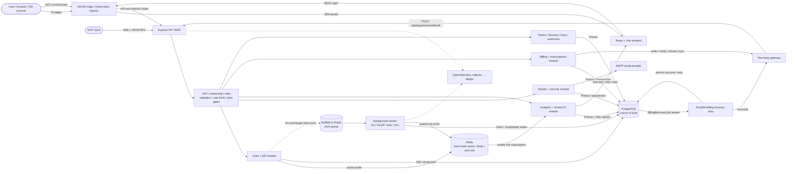
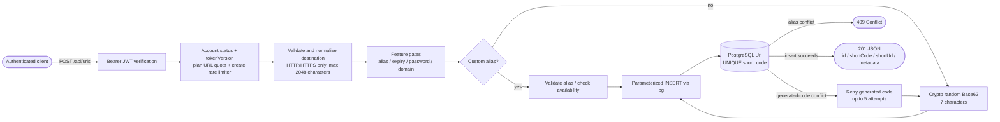
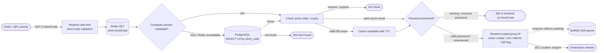
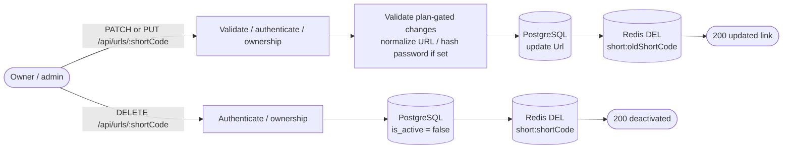
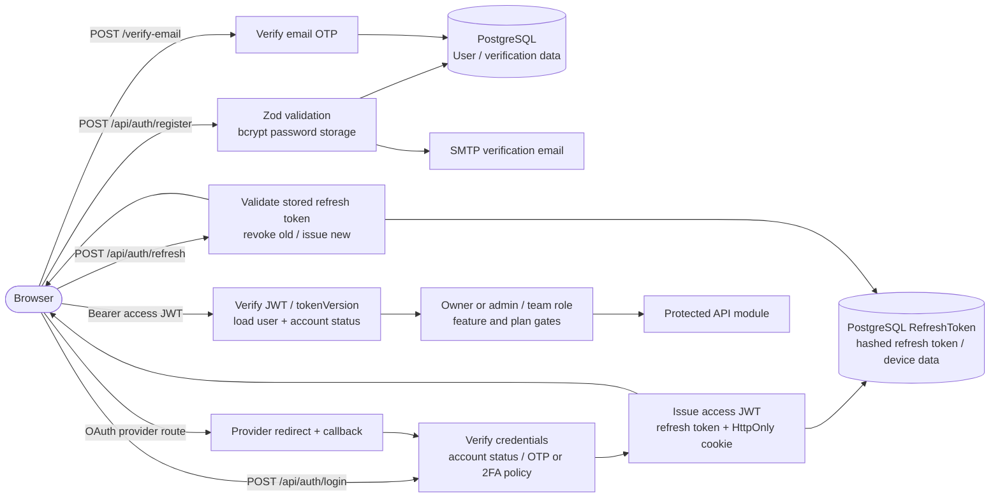
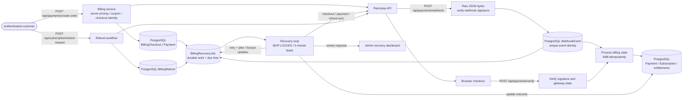
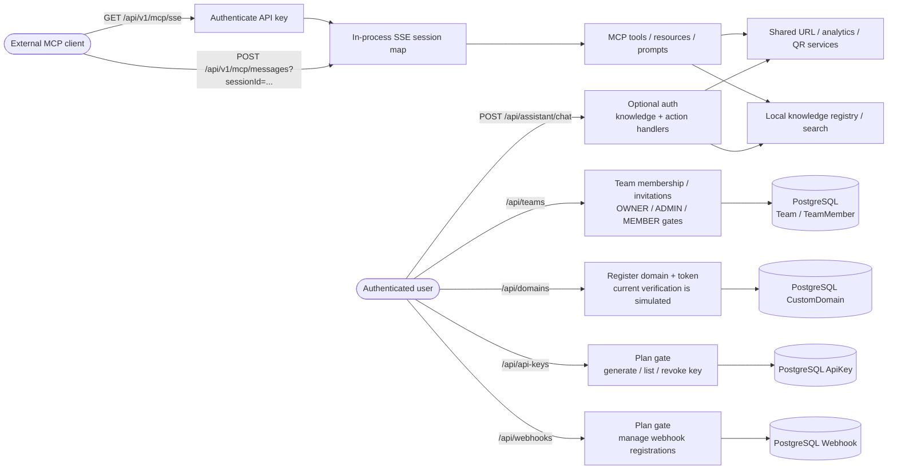
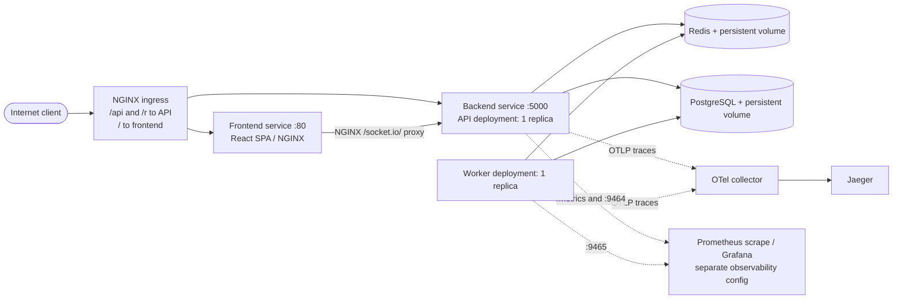
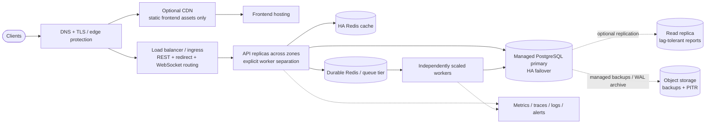

# PBUrls — Detailed project architecture and API flows

Code-based architecture snapshot · 23 October 2026

This document follows the reference image's flowchart style: clients on the left, services in the middle, cylinder-shaped data stores on the right, and labeled arrows. The diagrams describe the checked-in working tree, including local changes. They are based on source inspection, not a running deployment or measured performance.

Open `PROJECT_ARCHITECTURE.svg` for the clean overview, or `PROJECT_ARCHITECTURE.html` for the overview, detailed diagrams, and searchable API catalog. The Mermaid sources below remain editable.

## 1. System overview — implemented components

The backend is an Express modular monolith with separately runnable background workers. Authentication, links, analytics, billing, teams, and MCP are modules inside the same API application; they are not independently deployed microservices.



**Deployment distinction:** Docker Compose declares frontend, API, worker, PostgreSQL, Redis, an OTel collector, and Jaeger. Kubernetes declares one API and one worker replica. Neither configuration establishes multi-AZ database failover, read replicas, a CDN, or object-storage backups.

## 2. Link creation — write path



The database uniqueness constraint resolves concurrent code allocation. Creation does not pre-warm the redirect cache: the first successful redirect populates it. Passwords are bcrypt-hashed before insertion. Generated codes use `62^7` possible combinations; exhausting allocation retries produces an error with status 503.

`POST /api/urls/bulk` runs a plan check and sequentially creates the supplied links. It is not an all-or-nothing database transaction; a later item can fail after earlier items have been inserted.

## 3. Redirect — latency-sensitive read path



Cache values contain the URL ID, destination, password hash, active flag, and expiry. TTL is configurable through `config.cacheTtl`. Redis cache failures fall back to PostgreSQL. A successful redirect does not wait for click persistence; an enqueue failure can lose analytics while the redirect still succeeds.

QR generation encodes `/r/:shortCode?src=qr`. Redirect tracking also recognizes `qr=true` and `qr=1`.

## 4. Link edits, deletion, and cache consistency



Delete is a soft delete. Cache invalidation is best-effort: failed invalidation may leave an old cache value until its TTL expires. There is no atomic transaction spanning PostgreSQL and Redis, and a concurrent cache fill can race with mutation. The architecture does not promise instantaneous consistency under those failures.

## 5. Click analytics — asynchronous processing and realtime delivery

```mermaid
flowchart LR
  Q[(Redis / BullMQ<br/>click-queue)] --> W[Click consumer<br/>concurrency 5]
  W --> UA[UA parsing<br/>browser / OS / device]
  UA --> GEO[IP geolocation<br/>resolveGeoLocation]
  GEO --> BOT[User-agent bot heuristics<br/>Redis behavior-rate check]
  BOT --> H[(Redis HLL<br/>hll:urlId:UTC-date<br/>2-day TTL)]
  H --> C[(PostgreSQL<br/>insert Click)]
  C --> HR[(PostgreSQL<br/>upsert UrlStatsHourly)]
  HR --> DR[(PostgreSQL<br/>upsert UrlStatsDaily)]
  DR --> RT[(Redis<br/>rt_clicks:urlId:minute<br/>10-minute TTL)]
  RT --> PUB[Publish ws:url:ID<br/>invalidate overview cache keys]
  PUB --> SUB[API subscribes to ws:url:*]
  SUB --> SOCK[Socket.IO URL room<br/>authorized join-url]
  SOCK -->|click-tick| UI([Dashboard])
  UI -->|GET /api/analytics/:urlId/*| API[JWT + ownership<br/>feature + retention checks]
  API --> DB[(PostgreSQL<br/>raw Click queries / aggregates)]
  DB --> API
  API -->|JSON reports or CSV export| UI
```



Each click is processed with individual insert/upsert calls; this is not a batch-flush worker. The click insert and two rollups are separate operations, so they can partially succeed. The worker writes rollups, but current report services also query raw `Click` records; report requests do not exclusively read rollup tables.

`PFADD` is used to derive the current `is_unique` flag. Its return value indicates whether HLL registers changed, not exact first-visit membership. Treat the resulting unique metric as approximate. Rollup totals exclude detected bots, while raw-report filters depend on each query.

Click jobs retain up to 1,000 completed and failed jobs under the configured retention options. The producer does not configure an `attempts` or backoff policy, and the pipeline has no explicit event-level deduplication or exactly-once guarantee.

Socket connections use a JWT in the handshake. Clients request `join-url` with a numeric URL ID; server-side authorization checks access before joining `url:ID`. Worker messages become `click-tick` events. A Redis Socket.IO adapter is configured for cross-process delivery, but current manifests use one API replica. Review duplicate broadcast behavior when scaling: each API subscribes to worker messages and its `io.to(...).emit(...)` can also fan out through the adapter.

## 6. Identity, sessions, and authorization



Platform roles are `USER` and `ADMIN`; team roles are `OWNER`, `ADMIN`, and `MEMBER`. Route-specific ownership checks and subscription gates supplement authentication. REST routes use Bearer JWTs; API keys are used by the MCP transport and do not automatically replace JWT authentication across REST routes. Short-code lookup remains global; the redirect path does not resolve `(host, shortCode)` as a tenant-specific key.

Security endpoints allow listing/revoking sessions and reading login history. Sensitive admin routes apply step-up confirmation where declared, with audit records for wrapped actions. Exact token lifetimes and cookie options are configuration-driven; do not infer them from README examples.

## 7. Billing, webhooks, and durable recovery



The payment webhook is registered before `express.json()` so signature verification receives the raw body. Recovery is backed by PostgreSQL and can continue without Redis. It seeds work from durable checkout, payment, refund, and unprocessed webhook records, claims jobs with leases, and fences updates by lease token. Retry delays grow with jitter and are capped at one day; repeated errors set a review flag.

The main background entry point starts the recovery loop, a click consumer, a health consumer, and a billing/dunning consumer. Health jobs are scheduled every six hours; billing/dunning jobs are scheduled daily at midnight, with startup runs as well. Those cron expressions do not explicitly select Asia/Calcutta; their effective timezone depends on scheduling/runtime configuration. `npm run worker:billing` is a standalone recovery entry point but is not separately declared in the root Compose stack.

## 8. Teams, domains, developer integration, and assistant



The MCP router also mounts at `/api/mcp`; its SSE transport advertises the canonical `/api/v1/mcp/messages` endpoint. A stdio entry point exists at `backend/bin/pburls-mcp.js`. Session state lives in memory, so horizontally scaled SSE/message routing needs session affinity or a redesigned transport/session layer.

Custom-domain registration exists, but the controller marks verification successful through a simulated resolver. Real DNS proof, host-aware redirects, and automatic TLS issuance are not established by that API. Webhook registration APIs store configuration; this diagram does not assume a guaranteed outbound delivery/retry subsystem. The assistant uses local knowledge/search and service handlers; no external LLM service is assumed here.

## 9. Data ownership and storage

| Domain | PostgreSQL models | Main responsibility |
|---|---|---|
| Identity | User, RefreshToken, LoginEvent | Accounts, token rotation, login/session history |
| Link management | Url, CustomDomain | Destination, globally unique code, ownership, expiry, password, domain association |
| Analytics | Click, UrlStatsHourly, UrlStatsDaily | Raw events and independently written rollups |
| Collaboration | Team, TeamMember | Membership, invitation state, team roles |
| Plans | Plan, PlanLimit, Subscription | Price catalog, entitlements, subscription lifecycle |
| Billing | BillingProfile, BillingCheckout, Payment, BillingRefund | Billing identity, checkout state, invoices/payments, refunds |
| Recovery | WebhookEvent, BillingRecoveryJob | Durable webhook identity and reconciliation work |
| Promotions | Coupon, CouponRedemption | Discount rules and per-user redemptions |
| Developer access | ApiKey, Webhook | API key and webhook registration records |
| Administration | AdminAuditLog, ApprovalRequest | Audited mutations and approval workflows |

The `Url` repository uses the `pg` pool and parameterized SQL; much of the remaining application uses Prisma. Both access the same PostgreSQL database. URL and Click IDs are BigInts serialized as strings in API payloads.

Important constraints include unique `Url.short_code`, unique `(team_id, user_id)` membership, unique hourly/daily URL buckets, unique `(user_id, request_key)` checkout identity, and indexes on `(url_id, clicked_at)` for event queries.

| Redis data | Purpose / lifetime |
|---|---|
| `short:{shortCode}` | Redirect metadata; configurable cache TTL |
| `status:{userId}` | Account status cache; 300 seconds |
| `hll:{urlId}:{date}` | Approximate daily visitor sketch; 2 days when updated |
| `rt_clicks:{urlId}:{minute}` | Minute click counter; 600 seconds |
| `ws:url:{urlId}` | Pub/sub channel, not durable storage |
| BullMQ queue keys | Click, health, billing/dunning jobs |
| Plan/rate-limit and overview-cache keys | Route/service-specific temporary state |

## 10. API contracts — representative requests

The implemented REST base is `/api`, not `/api/v1/links`. Paths containing `:id`, `:urlId`, or `:shortCode` require substituting an actual value. Most protected endpoints require `Authorization: Bearer <access-token>`. Individual routes may add a plan feature, ownership, team role, or admin requirement.

### Create a short link

```http
POST /api/urls
Authorization: Bearer <access-token>
Content-Type: application/json

{
  "longUrl": "https://example.com/products?utm_source=newsletter",
  "customAlias": "autumn-offer",
  "expiresAt": "2026-12-01T00:00:00.000Z"
}
```

Optional fields also include `password` and `customDomainId`; plan rules can restrict them. `customAlias` is 3–64 letters, digits, underscores, or hyphens. Omit it to generate a random seven-character code.

Illustrative response subset, not a live response:

```json
{
  "success": true,
  "data": {
    "id": "123",
    "longUrl": "https://example.com/products?utm_source=newsletter",
    "shortCode": "autumn-offer",
    "shortUrl": "https://<configured-base-host>/r/autumn-offer",
    "isActive": true,
    "expiresAt": "2026-12-01T00:00:00.000Z",
    "passwordProtected": false
  }
}
```

### Visit, edit, QR, and analytics

```http
GET /r/autumn-offer
```

Returns `302` and a destination `Location` header for a valid unprotected link. Password-protected links may redirect to the frontend password page instead.

```http
PATCH /api/urls/autumn-offer
Authorization: Bearer <access-token>
Content-Type: application/json

{"longUrl":"https://example.com/new-offer"}
```

```http
GET /api/urls/autumn-offer/qr
Authorization: Bearer <access-token>
```

Returns `{ "success": true, "qrCodeDataUrl": "data:image/png;base64,..." }` when the owner and plan checks pass.

```http
GET /api/analytics/123/overview?range=7d
GET /api/analytics/123/timeseries?range=7d
GET /api/analytics/123/locations?range=7d
GET /api/analytics/123/export?range=7d
Authorization: Bearer <access-token>
```

Analytics uses numeric URL IDs, not short codes. Report access also applies retention and feature rules. Overview data includes total, unique, bot and QR counts, live clicks, recent clicks, growth, and the selected period. Export returns CSV.

### Authentication and billing entry points

```http
POST /api/auth/login
Content-Type: application/json

{"email":"user@example.com","password":"<account-password>"}
```

The response may require another verification step according to account and 2FA policy. Refresh rotates the persisted refresh token through `POST /api/auth/refresh`; logout revokes it through `POST /api/auth/logout`.

Checkout flows through `POST /api/payments/create-order`, provider checkout, and `POST /api/payments/verify`. Browser recovery can call `POST /api/payments/:id/sync` or `POST /api/payments/checkouts/:id/sync`. Server recovery does not depend on the browser remaining open. Exact billing inputs are governed by the billing controller/service rather than an invented universal payment schema.

Common error envelope:

```json
{"success":false,"message":"URL not found","code":"NOT_FOUND"}
```

| HTTP status | Typical meaning |
|---|---|
| 200 / 201 / 202 | Successful read/update, created resource, accepted/queued operation |
| 302 | Redirect to destination or frontend password page |
| 400 | Invalid input |
| 401 | Missing/invalid/expired authentication |
| 403 | Role, feature, status, or plan restriction |
| 404 | Missing resource or ownership boundary, depending on route |
| 409 | Alias or other uniqueness conflict |
| 410 | Inactive or expired link |
| 429 | Rate limited; shared error handler sets Retry-After |
| 500 / 503 | Internal failure / code allocation exhaustion |

## 11. Infrastructure and observability



Root Docker Compose publishes frontend `3000`, API `5000`, database host port `5435`, Redis `6379`, trace UI `16686`, and separate backend/worker metrics ports. Do not infer public production exposure from these local port mappings.

The frontend NGINX configuration proxies `/api/`, `/r/`, and WebSocket upgrades under `/socket.io/`. The Kubernetes ingress has explicit `/api` and `/r` routes; `/socket.io/` falls through to the frontend service. That frontend config targets the Compose hostname `backend`, whereas Kubernetes names the service `backend-service`; align upstream DNS and/or add a direct Socket.IO ingress route before relying on that Kubernetes path. Kubernetes ingress currently has no TLS block and sets SSL redirect to false.

`GET /health` confirms that the API process responds; it does not probe PostgreSQL, Redis, or queue readiness. Backend readiness/liveness probes both use this route. Compose disables the API's automatic child worker because it declares a dedicated worker service. The API otherwise forks the main worker by default; preserve that separation when scaling.

## 12. Proposed production evolution — not currently deployed



This is an extension of the project, not a claim about its present deployment. Keep redirects reaching the origin if every click must be observed; caching HTTP redirects at a CDN can bypass expiry/password checks and click ingestion unless explicitly designed around them.

Before claiming this target architecture, implement database backup/restore verification, failover, appropriate Redis persistence, TLS/DNS automation, separate cache/queue resource policies, connection-pool budgets, queue retry/deduplication behavior, and scaling-safe realtime/MCP routing. Add an outbox or another durable event handoff if redirect-associated event loss must be reduced. The redirect latency/telemetry durability tradeoff should be explicit.

## 13. Source map

| Concern | Source |
|---|---|
| API mounts / middleware / webhook raw body | `backend/src/app.js` |
| Runtime / child worker / Socket.IO initialization | `backend/server.js` |
| Route contracts | `backend/src/routes/*.routes.js` |
| Link creation, redirect, event enqueue | `backend/src/controllers/url.controller.js` |
| Link lifecycle / cache-aside / QR | `backend/src/services/url.service.js` |
| SQL link repository | `backend/src/repositories/url.repository.js` |
| Code allocation | `backend/src/utils/generateShortCode.js` |
| Redirect cache | `backend/src/services/cache.service.js` |
| Actual click queue producer | `backend/src/queues/clickQueue.js` |
| Active ingestion / health / dunning entry | `backend/worker/index.js` |
| Current Socket.IO implementation | `backend/src/config/socket.js` |
| Analytics queries | `backend/src/services/analytics.service.js`, `locationAnalytics.service.js` |
| Billing persistence / gateway / recovery | `backend/src/services/billing.service.js`, `billingGateway.js`, `billingRecovery.js` |
| MCP transport | `backend/src/mcp/transports/sse.transport.js` |
| Data models | `backend/prisma/schema.prisma` |
| Local deployment | `docker-compose.yml`, `frontend/nginx.conf` |
| Cluster deployment | `infrastructure/kubernetes/*.yaml` |

The older `backend/src/analytics/queue.js`, `backend/src/analytics/socket.js`, and alternate worker paths are not substituted for the entry points imported by the current server and npm worker command.

## 14. Complete mounted API inventory

The companion `PROJECT_API_CATALOG.md` is generated from literal Express router declarations and the mounts in `app.js`. It includes handler names for tracing request ownership in code. Declared routes are source contracts, not proof of runtime availability; conditional paths such as mock payments and evaluator bypass may be disabled or rejected by configuration.
