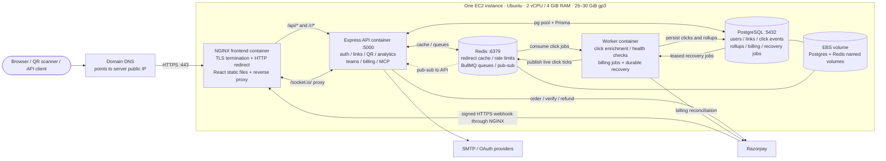

# PBUrls — Single EC2 server with Docker Compose

Corrected deployment design · 23 October 2026

This design adapts the project to one Ubuntu EC2 instance with Docker Engine and Docker Compose. It is a proposed deployment configuration based on the current application source, not a claim that these production settings are already configured. Kubernetes and the observability services are excluded. Application analytics, realtime dashboards, billing, and background jobs remain.

## Corrected flow diagram

The React app is built once and served as files by NGINX; there is no production Vite development server. This uses the existing frontend container as the single web edge, after adding HTTPS and certificate configuration. Port 80 redirects users to HTTPS; certificate challenge handling may also use port 80.

An external CDN can be added in front of the origin later. It is optional and does not require an AWS load balancer. A managed load balancer is also optional for this single-server topology. If an edge cache is introduced, avoid caching redirects or authenticated API responses until expiry, passwords, cache invalidation, and click-count behavior are deliberately handled.

## Correct API labels for the sketch

| User action | Implemented endpoint | NGINX destination |
|---|---|---|
| Open UI | `GET /`, dashboard and other SPA routes | React static files / SPA fallback |
| Register | `POST /api/auth/register` | Express API |
| Verify email | `POST /api/auth/verify-email` | Express API |
| Login | `POST /api/auth/login` | Express API |
| Refresh session | `POST /api/auth/refresh` | Express API |
| Create short link | `POST /api/urls` | Express API; Bearer JWT required |
| List my links | `GET /api/urls/me` | Express API; Bearer JWT required |
| Follow short link | `GET /r/:shortCode` | Express API; returns 302 when valid |
| Edit link | `PATCH /api/urls/:shortCode` | Express API; auth + ownership |
| Deactivate link | `DELETE /api/urls/:shortCode` | Express API; auth + ownership |
| Generate QR | `GET /api/urls/:shortCode/qr` | Express API; auth + ownership + plan |
| Read analytics | `GET /api/analytics/:urlId/overview?range=7d` | Express API; auth + ownership |
| Live analytics | `/socket.io/` | Socket.IO WebSocket / polling proxy |
| Payment webhook | `POST /api/payments/webhook` | API raw-body signature verification |
| MCP | `/api/v1/mcp/sse`, `/api/v1/mcp/messages` | API SSE / JSON-RPC transport |

The sketch's `GET /api/short`, `GET /api/short_url`, `POST /api/long_url`, and `/api/signup` are not the project's actual routes. Use `https://your-domain/...`; HTTP methods such as GET and POST are request metadata, not part of a URL.

## RAM and CPU planning

These are starting planning ranges for low traffic, not measured usage, guarantees, or recommended hard container limits. Actual memory depends on concurrency, queue depth, Redis contents, database connections, and data size. The worker imports `geoip-lite`, and the API and worker are separate Node processes, so a combined 250 MB assumption is too optimistic to budget around.

| Component | Initial RAM planning range |
|---|---:|
| Express API | 250–500 MiB |
| Background worker, including local geolocation data | 400–800 MiB |
| Redis cache + queues | 150–300 MiB initially; grows with retained data |
| PostgreSQL with modest connection/concurrency settings | 300–600 MiB |
| NGINX + static React frontend | 30–80 MiB |
| Ubuntu and host services | 400–700 MiB |
| Docker daemon/runtime overhead | 100–200 MiB |
| **Planning total** | **1,630–3,180 MiB (~1.6–3.1 GiB)** |

**Starting server size: 2 vCPU and 4 GiB RAM.** This is a reasonable starting allocation for this five-container, low-traffic deployment, with validation under actual traffic still needed. A 2 GiB server leaves much less room for the worker, PostgreSQL, bursts, and builds. Building images in CI and deploying prebuilt images avoids frontend/npm build peaks on the instance.

CPU usage is workload-dependent; do not add fixed idle CPU numbers and treat the result as required capacity. `1,000 millicpu = 1 vCPU`; `700 millicpu = 0.7 vCPU`. Millicpu is a CPU unit, not MB. In Compose, CPU constraints are expressed through supported Compose resource settings such as `cpus`; Kubernetes requests are irrelevant to this deployment.

If selecting a T3 instance, account for burstable CPU credits. The AWS T3 table lists t3.medium as 2 vCPUs, 4 GiB, and a 20% baseline per vCPU. Two available vCPUs do not imply two continuously busy cores at the base instance price.

## Disk planning

Use **25–30 GiB gp3**, with **30 GiB** providing a little more room. A 4.7 GB total estimate is too tight for the operating system, image layers, database/WAL growth, container logs, and updates.

| Disk use | Starting budget, not measured size |
|---|---:|
| Ubuntu and packages | 4–6 GiB |
| Docker images and runtime layers | 3–5 GiB |
| Initial database, Redis persistence, WAL, and bounded logs | 4–8 GiB |
| Free space for updates, growth, and image replacement | 8–10 GiB |

Click records grow with traffic; these budgets do not define retention capacity. The API and worker can share the same backend image layers; do not assume two containers require two full image copies. Docker Engine/Compose installation size and image sizes should be measured, not set to a fixed 500 kB/500 MB estimate.

PostgreSQL and Redis named volumes live on the server's EBS filesystem. A named volume is persistent storage, not a backup. Keep database backups outside this server. Enable and size Redis persistence explicitly if queued clicks need to survive Redis/container restarts; a mounted volume alone does not guarantee durable queue writes. Redis is used for BullMQ as well as caching, so a cache-style all-keys eviction policy can damage queue state.

## Cost corrections

An hourly price must be multiplied by the monthly running hours:

`$0.08/hour × 730 hours ≈ $58.40/month`, before storage and other charges.

Illustrative On-Demand example for Linux/Unix in **US East (Northern Virginia)**, using the prices displayed on the AWS pages checked on 23 October 2026:

| Item | Illustrative monthly amount |
|---|---:|
| t3.medium at the displayed $0.0418/hour × 730 | $30.51 |
| 30 GB gp3 at the referenced $0.08/GB-month example rate | $2.40 |
| One public IPv4 address at $0.005/hour × 730 | $3.65 |
| **Illustrative subtotal** | **$36.56/month** |

Verify the EC2/EBS prices for the actual region before purchasing; Mumbai is not priced using this US-region example. This subtotal excludes applicable data transfer, domain/DNS, backups/snapshots, taxes, optional CDN services, and possible burst CPU charges. It does not assume credits, free-tier eligibility, reservations, or a Savings Plan.

gp3 includes **3,000 IOPS and 125 MiB/s** baseline volume performance. The sketch's **10,000 IOPS + 250 MB/s free** claim is incorrect. Additional provisioned performance can cost more, and realized throughput is also limited by the instance.

Sources:

- [AWS T3 instance specifications and displayed pricing](https://aws.amazon.com/ec2/instance-types/t3/)
- [AWS EBS pricing and gp3 baseline](https://aws.amazon.com/ebs/pricing/)
- [AWS public IPv4 pricing](https://aws.amazon.com/vpc/pricing/)

## Changes needed to apply this design

These are deployment instructions; the current application/Compose configuration has not been changed by this document.

1. Keep the five runtime services: frontend/NGINX, backend API, worker, PostgreSQL, Redis.
2. Omit OTel collector and Jaeger from the deployment. Do not start the separate Prometheus/Grafana observability stack. Kubernetes manifests are not used.
3. Set `OTEL_SDK_DISABLED=true` for both API and worker; remove their collector dependencies and exporter endpoints from the deployed Compose configuration.
4. Keep `DISABLE_CHILD_WORKER=true` on the API because the dedicated worker container already runs `npm run worker`. This prevents another worker process being forked inside the API container.
5. Configure the frontend build to use the deployed API origin. A same-origin `/api` base avoids embedding `http://localhost:5000/api` in public browser assets; confirm the frontend's API-base handling when setting the build argument.
6. Configure NGINX for the real domain and TLS certificate plus renewal. Its current config listens only on port 80 and does not already terminate HTTPS. Preserve `/api/`, `/r/`, and `/socket.io/` proxying; configure SSE proxy buffering/timeouts appropriately if using MCP remotely.
7. Publish NGINX on ports 80 and 443. Keep PostgreSQL, Redis, and the API on the private Compose network; do not publish their ports to the public internet. Restrict administrative SSH access.
8. Remove published metrics ports 9464/9465. The source still creates internal metrics servers and exposes API `/metrics`; `OTEL_SDK_DISABLED=true` disables OTel startup/export, not all application instrumentation. No telemetry services are needed for those unused internal endpoints. Basic application/error logs and `/health` can remain.
9. Persist PostgreSQL and Redis with named volumes; configure log rotation, queue retention, and external backups. Keep Compose database credentials and application connection settings consistent without baking secrets into images.
10. Use the intended trusted-proxy setting for the NGINX boundary so visitor IPs remain correct. Preserve raw payment-webhook bytes through the proxy. Validate auth, redirects, live events, billing callbacks, and restart recovery after deployment.

This is a single-server deployment: restarting or losing the EC2 host affects the UI, API, queues, and database together. A CDN does not change that origin availability characteristic.
