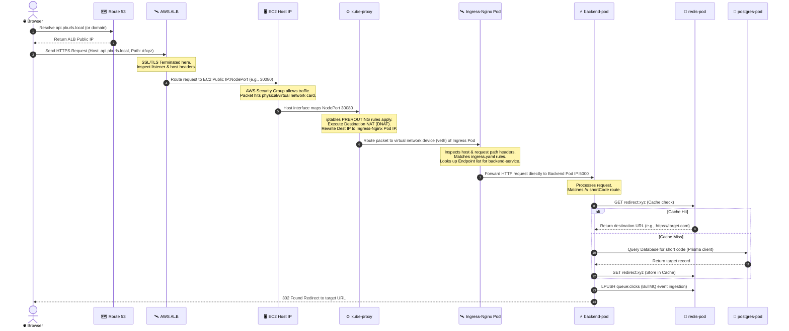

# 🌐 End-to-End Traffic Flow Architecture: Browser to AWS Single-Node EC2 Kubernetes (Ubuntu)

This document provides a comprehensive, packet-level analysis of how traffic routes through the PBUrls platform—from a user's web browser, across the internet to Amazon Web Services (AWS), into the Application Load Balancer (ALB), and down through a single-node Kubernetes cluster (running on an Ubuntu EC2 instance) to the application pods.

For the system design details of other components, see the [system_desing_dsa](file:///c:/Users/prash/OneDrive/Desktop/url_shortner/system_desing_dsa/) directory.

---

## 🏛️ System Architecture & Isolation Boundaries (Nested Boxes)

The diagram below represents the exact network and structural boundaries. It demonstrates how traffic traverses the different infrastructure levels (AWS Cloud VPC ➔ Security Groups ➔ EC2 host interface ➔ Linux kernel ➔ Kubernetes cluster ➔ namespaces and pods).

```mermaid
flowchart TB
    %% Styling Definitions
    classDef client fill:#f7fafc,stroke:#4a5568,stroke-width:2px,color:#2d3748;
    classDef aws fill:#fffaf0,stroke:#dd6b20,stroke-width:2px,color:#2d3748;
    classDef vpc fill:#f7fafc,stroke:#dd6b20,stroke-width:1px,stroke-dasharray: 5 5,color:#2d3748;
    classDef ec2 fill:#edf2f7,stroke:#3182ce,stroke-width:2px,color:#2d3748;
    classDef kernel fill:#f7fafc,stroke:#4a5568,stroke-width:1px,stroke-dasharray: 2 2,color:#2d3748;
    classDef k8s fill:#ebf8ff,stroke:#00b4d8,stroke-width:2px,color:#2d3748;
    classDef appgroup fill:#ffffff,stroke:#718096,stroke-width:1px,color:#2d3748;
    classDef component fill:#ffffff,stroke:#2d3748,stroke-width:1px,color:#2d3748;

    subgraph ClientZone ["🌐 Client Side"]
        Browser["🌐 Web Browser (Client)"]
    end
    class ClientZone client;

    subgraph AWSCloud ["☁️ AWS Cloud Platform"]
        Route53["🗺️ Route 53 (DNS Resolver)"]
        
        subgraph VPC ["🔒 Virtual Private Cloud (VPC Boundary)"]
            ALB["🛰️ Application Load Balancer (ALB)<br/>(SSL/TLS Termination & L7 Routing)"]
            
            subgraph SecurityGroup ["🛡️ EC2 Security Group (Port Firewall Rules)"]
                subgraph UbuntuHost ["🖥️ Single-Node EC2 Instance (Ubuntu Host)"]
                    NIC["🔌 Virtual Network Interface (eth0/ens3)<br/>IP: 10.0.0.150"]
                    
                    subgraph Kernel ["🐧 Linux Kernel Network Stack"]
                        KubeProxy["⚙️ kube-proxy / iptables Rules<br/>(DNAT: Host NodePort ➔ Pod IP)"]
                        CNI["🕸️ Container Overlay Network Interface<br/>(flannel/calico bridge)"]
                    end
                    class Kernel kernel;
                    
                    subgraph K8sCluster ["☸️ Kubernetes Cluster (Namespace: pburls)"]
                        IngressNginx["🛰️ Nginx Ingress Controller Pod<br/>(Receives decrypted HTTP payload)"]
                        
                        subgraph AppServices ["📦 Application Services Container Group"]
                            FrontendPod["🎨 Frontend Pod<br/>(Vite React + Nginx Static Host)"]
                            BackendPod["⚡ Backend Pod<br/>(Node.js Express API Server)"]
                            WorkerPod["⚙️ Background Worker Pod<br/>(BullMQ Queue Worker)"]
                        end
                        class AppServices appgroup;
                        
                        subgraph StorageServices ["🗄️ Cache & Database Container Group"]
                            RedisPod["🛑 Redis Pod<br/>(In-Memory Cache & Queues)"]
                            PostgresPod["🐘 PostgreSQL Pod<br/>(Prisma relational storage)"]
                        end
                        class StorageServices appgroup;
                    end
                    class K8sCluster k8s;
                end
                class UbuntuHost ec2;
            end
            class SecurityGroup client;
        end
        class VPC vpc;
    end
    class AWSCloud aws;
    class Browser,Route53,ALB,NIC,KubeProxy,CNI,IngressNginx,FrontendPod,BackendPod,WorkerPod,RedisPod,PostgresPod component;

    %% Logical Routing Interconnections
    Browser -.->|1. Resolve api.pburls.local| Route53
    Route53 -.->|2. Return ALB IP| Browser
    Browser ===>|3. HTTP/HTTPS requests (80/443)| ALB
    ALB ===>|4. Route to EC2 IP + NodePort (30080/30443)| NIC
    NIC ===>|5. Forward port packet| KubeProxy
    KubeProxy ===>|6. DNAT rewrite to Ingress Pod IP| CNI
    CNI ===>|7. Send payload to Pod| IngressNginx
    
    IngressNginx ===>|8a. Route / to Frontend IP| FrontendPod
    IngressNginx ===>|8b. Route /api & /r to Backend IP| BackendPod
    
    BackendPod -.->|Read/Write Cache & Session| RedisPod
    BackendPod -.->|Relational queries (Prisma)| PostgresPod
    BackendPod -.->|Push click events to BullMQ| RedisPod
    WorkerPod -.->|Pop events from BullMQ| RedisPod
    WorkerPod -.->|Batch save aggregated statistics| PostgresPod
```

---

## ⏱️ Chronological Flow Sequence (Client to DB)

Below is the step-by-step sequence of events when a client triggers an API request or visits a short link:



---

## ⚡ Step-by-Step Deep-Dive of the Network Journey

### Phase 1: DNS & Browser to AWS Edge
1. **DNS Resolution**: 
   The user types a URL (e.g., `https://api.pburls.local/r/xyz`) or accesses the frontend dashboard. The browser issues a DNS request. Amazon Route 53 resolves the request, returning the IP address(es) of the **AWS Application Load Balancer (ALB)**.
2. **TCP & TLS Handshake**:
   The browser establishes a TCP connection on port `443` (HTTPS) with the ALB. The TLS handshake is completed at the ALB, which decrypts the payload and prepares to process the raw HTTP request.

### Phase 2: Inside the AWS ALB
1. **Header Evaluation**:
   The ALB acts as a Layer 7 (Application Layer) reverse proxy. It inspects the `Host` header (`api.pburls.local` or `pburls.local`) and the request path (e.g., `/api/auth/login` vs `/r/xyz`).
2. **Listener Rules & Routing**:
   The ALB matches the host and path against configured rules to determine the correct **Target Group**.
3. **Forwarding to Single-Node EC2**:
   Because this is a single-node EC2 cluster (running Ubuntu), the Target Group contains a single target: the private IP of the EC2 instance.
   * **Target Port**: In a standard Kubernetes setup, the ALB targets the **NodePort** exposed by the Nginx Ingress Controller service (typically in the `30000-32767` range, e.g., port `30080` for HTTP and `30443` for HTTPS).

### Phase 3: Entering the Ubuntu EC2 Host
1. **Security Group Validation**:
   The packet reaches the Virtual Private Cloud (VPC) boundary. The AWS EC2 **Security Group** acts as a virtual firewall. It evaluates the incoming request and allows it only if there is an inbound rule permitting traffic from the ALB's security group to the designated NodePorts on the EC2 instance.
2. **Network Card (NIC) Ingestion**:
   The packet is received by the virtual network interface of the Ubuntu host (usually `eth0` or `ens3`).

### Phase 4: Host-Level Packet Routing (kube-proxy & iptables)
1. **Packet Interception**:
   Once the packet enters the host networking stack, it is intercepted by the Linux kernel's netfilter firewall.
2. **kube-proxy Execution**:
   `kube-proxy` running on the node keeps the local `iptables` or IPVS rules synchronized with the Kubernetes API state.
3. **Destination NAT (DNAT)**:
   The packet's destination port is identified as the NodePort (e.g., `30080`). The `iptables` rules perform Destination Network Address Translation (DNAT) to balance traffic and forward it:
   * **Source IP**: Replaced with the EC2 Node IP (or remains the client's IP depending on the Service's `externalTrafficPolicy`).
   * **Destination IP**: Rewritten from the EC2 Host IP to the virtual cluster IP of the **Ingress-Nginx Pod** (e.g., `10.244.x.y`).
4. **Overlay Network Transit**:
   The packet is routed over the container overlay network bridge (such as Flannel or Calico) and pushed through the virtual ethernet pair (`veth`) corresponding to the Ingress Nginx pod container namespace.

### Phase 5: Ingress Nginx Controller Routing
1. **Request Matching**:
   The Nginx Ingress Controller Pod receives the raw HTTP packet. It matches the HTTP hostname and path against rules parsed from [ingress.yaml](file:///c:/Users/prash/OneDrive/Desktop/url_shortner/infrastructure/kubernetes/ingress.yaml):
   * **Path `/api` or `/r`**: Targets the `backend-service` (port `5000`).
   * **Path `/` (default)**: Targets the `frontend-service` (port `80`).
2. **Service Endpoint Resolution (Direct Pod Routing)**:
   Rather than forwarding the packet to the service's `ClusterIP` (which would trigger a second slow trip through `iptables`), Nginx Ingress Controller optimizes this path:
   * It watches the `Endpoints` API directly.
   * It selects an active target pod IP (e.g., `backend-pod` IP `10.244.1.25` on port `5000`) and opens a direct HTTP connection to it.
   * It proxies the client request payload directly to this destination.

### Phase 6: Inside the Target Application Pods

#### Scenario A: The Redirect Path (`/r/:shortCode`)
If the client requested a shortlink redirection (e.g., `/r/xyz`):
1. **Request Reception**: The Express.js router in the `backend-pod` intercepts the route handler.
2. **Proxy Header Extraction**: The backend extracts the true visitor's IP address by looking up proxy headers (e.g. `X-Forwarded-For`) to preserve geographical analytics.
3. **Redis Cache-First Lookup (Read Path)**:
   * The backend queries the `redis-service` (`redis-service:6379`) using `GET redirect:xyz`.
   * **Cache Hit**: Returns the target URL (e.g., `https://google.com`).
   * **Cache Miss**: Queries the database (`postgres-service:5432`) via Prisma. It then writes the target URL back to Redis (`SET redirect:xyz EX 86400`) for subsequent hits.
4. **Async Event Queuing (Telemetry)**:
   Instead of waiting to parse geolocation or write database records synchronously, the backend pushes a lightweight click metadata job to **BullMQ** using the Redis connection:
   * Command: `LPUSH bull:clicks:queue <payload>`
5. **Immediate Response**:
   `backend-pod` returns an HTTP status code `302 Found` with the `Location` header pointing to the destination URL.
6. **Background Worker Processing**:
   The `worker-pod` receives the telemetry event from the Redis queue. It executes geographic lookups (`geoip-lite`), detects web crawler bots, runs sliding-window spam checks, and performs an optimized daily/hourly batch upsert on PostgreSQL (`UrlStatsDaily` / `UrlStatsHourly`).

#### Scenario B: The API path (`/api/...`)
If the client requests CRUD access, user logins, billing configurations, or team settings:
1. **Authentication Guard**: The Request passes through JWT validation middleware. The backend parses cookie headers for JWT state and verifies the signature using the configuration secret.
2. **Active Quota Checks**: Queries Redis quota hashes (`limits:userId`) to enforce active tenant tier configurations.
3. **Transactional Queries**: The backend runs queries against the PostgreSQL database (`postgres-service:5432`) utilizing Prisma ORM client connection pool.
4. **JSON Response**: The backend returns the JSON result payload. Nginx Ingress forwards it back to the ALB, which forwards it to the browser.

---

## 🔍 Network Address Translation (NAT) Mapping

The following matrix details the header changes applied to a network packet at each milestone of its journey from the client's web browser:

| Stage | Action | Source IP | Destination IP | Source Port | Destination Port |
| :--- | :--- | :--- | :--- | :--- | :--- |
| **1. Browser to ALB** | User initiates request | `Client IP` (Public) | `ALB IP` (Public) | `Client Ephemeral Port` | `443` (HTTPS) |
| **2. Inside ALB** | ALB terminates SSL, targets EC2 | `ALB Private IP` | `EC2 Private IP` | `ALB Ephemeral Port` | `30080` (NodePort) |
| **3. Host Interface** | Packet arrives at EC2 NIC | `ALB Private IP` | `EC2 Private IP` | `ALB Ephemeral Port` | `30080` (NodePort) |
| **4. kube-proxy (DNAT)** | iptables redirects to Pod | `ALB Private IP` *(or Client IP)* | `Ingress-Nginx Pod IP` | `ALB Ephemeral Port` | `80` (Container port) |
| **5. Ingress Controller** | Nginx proxies to target app | `Ingress Pod IP` | `Backend Pod IP` (or Frontend) | `Ingress Ephemeral Port` | `5000` (or `80` for Front) |
| **6. App Node DB / Cache** | Container communicates internally | `Backend Pod IP` | `Postgres / Redis Pod IP` | `Backend Ephemeral Port` | `5432` / `6379` |

---

## 🛡️ DevOps Configuration Checkpoints for AWS single-node setup

For this architecture to operate correctly on a single-node Ubuntu EC2 instance, ensure the following configuration files and values are set:

1. **Security Groups**:
   * **ALB Security Group**: Inbound TCP on `80` & `443` from `0.0.0.0/0`.
   * **EC2 Security Group**: Inbound TCP on NodePorts (e.g., `30000-32767`) restricted to source `ALB Security Group ID`. Avoid exposing NodePorts to the open internet.
2. **ALB Target Group Health Checks**:
   * Health checks must target the EC2 private IP on the HTTP NodePort (e.g., `30080`).
   * Health check path must resolve to a valid path inside the Kubernetes Ingress configurations (e.g. `/` or a dedicated ingress health check endpoint like `/healthz`).
3. **Kubernetes Service Inbound Configuration**:
   The Ingress Controller Service yaml must declare a type `NodePort` or `LoadBalancer` and bind port `80` to the target NodePort:
   ```yaml
   apiVersion: v1
   kind: Service
   metadata:
     name: ingress-nginx-controller
     namespace: ingress-nginx
   spec:
     type: NodePort
     ports:
       - name: http
         port: 80
         targetPort: http
         nodePort: 30080
       - name: https
         port: 443
         targetPort: https
         nodePort: 30443
     selector:
       app.kubernetes.io/name: ingress-nginx
   ```
